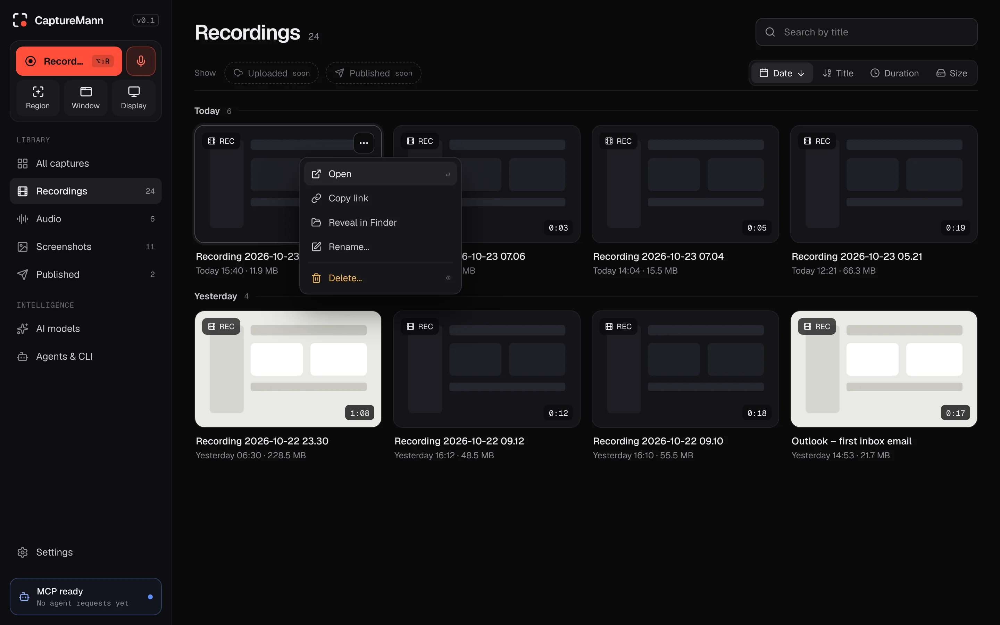
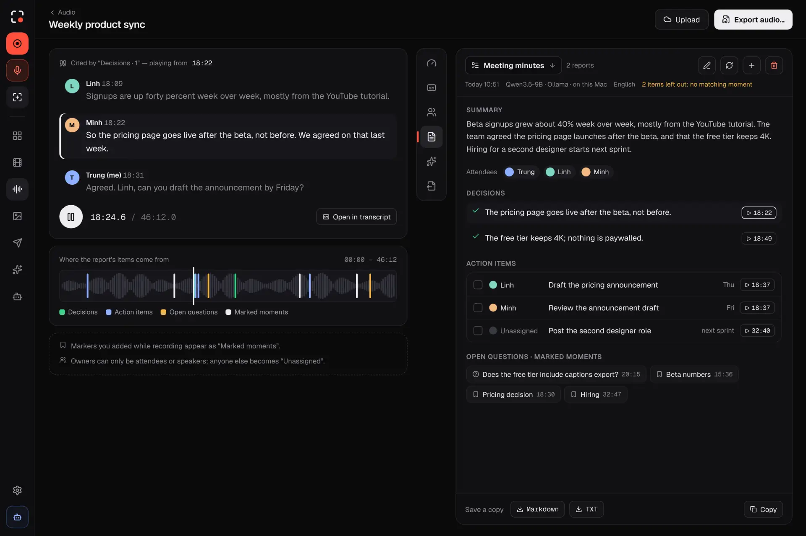

<h1 align="center">
  <picture>
    <source media="(prefers-color-scheme: dark)" srcset="design/brand/logo/svg/lockup-horizontal-on-dark.svg">
    
  </picture>
</h1>

<p align="center">
  <a href="https://www.craftmann.app/"></a>
</p>

<p align="center">
Free, open-source screenshots, screen recording and audio recording, with local AI captions,<br>
transcripts, meeting minutes and speaker labels, and every feature available to AI agents<br>
through MCP and a CLI.
</p>

<p align="center">
<a href="https://github.com/craft-mann/capturemann/actions/workflows/ci.yml"></a>
<a href="LICENSE"></a>
 
</p>

<p align="center">
  
</p>

> **Status: 0.2.3 (macOS 13+, Apple Silicon and Intel).** Windows, then Linux follow. Most results are
> tested with scripted fakes, plus the maintainer's own use on one Mac; there are few stored hardware
> reports. **Speaker labels** are measured on public English conversation clips only (diarization error
> 17 % on clips held back, [report](verification/benchmarks/speaker-detection-2026-10-29.md)); Vietnamese
> is not measured yet. **Intel:** the build installs, opens and asks for permissions on a real Intel Mac, but
> starting a recording crashed one (issue 16); 0.2.3 has a fix that is not confirmed yet. What is still
> unverified is tracked in [`specs/04-delivery-plan.md`](specs/04-delivery-plan.md) under "Verification
> debt" and in [`docs/project/status.md`](docs/project/status.md).

## Features

- **Screenshots** of a display, a window or a region, with an annotation editor and Auto-redact for
  emails, keys, phone numbers and IPs.
- **Screen recording** up to the display's native resolution (4K/5K) at 30 or 60 fps, with a webcam
  bubble, microphone (noise suppression), system audio and cursor telemetry. Pause, resume, and
  crash recovery that loses at most two seconds.
- **Editor**: trim, cut, split, speed, backgrounds, zoom regions, restylable cursor, 9:16 and 1:1
  reframe. Export to MP4, platform presets, GIF or WebM.
- **Audio recording**: meetings, interviews, lectures and voice notes from the microphone and,
  optionally, system audio. A compact recording bar with a level meter, markers (press `M`), a consent
  reminder, and a WAV master that survives a crash. An audio editor with a waveform, a transcript,
  trim and cut, and export to M4A or WAV with loudness levelling.
- **Local AI**, all on your Mac: Whisper transcripts and captions (SRT, VTT, TXT, or burned in) with
  Large v3 Turbo as the recommended model, a caption editor, translation to English with Whisper and to
  other languages with the built-in text model, and zoom and silence-cut suggestions. Models download
  only when you press Download.
- **Speaker labels**: who spoke when, from the voices, with rename and merge and a progress bar on long
  recordings. The two small models ship inside the app; nothing is sent anywhere. Tell the app which
  languages you speak (for example `vi, en`) so a short recording is not heard as a related language.
- **Meeting minutes and reports**: summary, minutes, one-on-one notes, interview notes, product
  recap and lecture notes written by a built-in text model (Gemma 4 E2B by default). Every item links
  to the moment it was said; export as Markdown or text. The model runs through a bundled
  `llama-server`; no cloud and no account. The picture below shows a report with sample data.
- **Library** of self-contained capture bundles, stored in a folder you choose.
- **Share**: save to local folders or Google Drive, publish to YouTube (private by default).
- **For agents**: 73 MCP tools plus resources and prompts, and an identical `capturemann` CLI. Risky
  actions (start recording, publish, delete) need an on-screen confirmation.
- **Private by design**: no telemetry, and no network traffic unless you connect a destination or
  download a model. You bring your own Google credentials; secrets live in the macOS Keychain.
- English and Vietnamese interface.

<p align="center">
  
</p>

## Install

Requires a Mac with macOS 13 or later, Apple Silicon or Intel (Apple menu > About This Mac shows the chip). There is one download per chip. **The Intel build (0.2.1 and later) is built and checked on Apple Silicon.** It installs and opens on a real Intel Mac, but starting a screen recording crashed a MacBook Pro 16" 2019 in 0.2.2 ([issue 16](https://github.com/craft-mann/capturemann/issues/16)); 0.2.3 catches the error and retries with simpler settings, which is not confirmed on that Mac yet. The speech and text models may be slow on older Intel Macs. Please report problems. The app is about 180 MB (Apple Silicon) or 190 MB (Intel).  The AI models are not in it: they download only when you press Download (about 4.4 GB for the recommended speech model, Large v3 Turbo, plus the recommended text model, Gemma 4 E2B). The two small speaker models are inside the app.

**With Homebrew:**

```sh
brew install --cask craft-mann/tap/capturemann
```

Homebrew picks the right build for your chip. This also links the `capturemann` command line into Homebrew's `bin`. Update with
`brew upgrade --cask capturemann`.

**From the release page:**

1. Download `CaptureMann-v<version>-macos-arm64.dmg` (Apple Silicon) or
   `CaptureMann-v<version>-macos-x86_64.dmg` (Intel) and its `.sha256` file from
   [Releases](https://github.com/craft-mann/capturemann/releases).
2. Check the download (in the folder with both files):
   `shasum -a 256 -c <the DMG's name>.sha256` must print `OK`.
3. Open the DMG and drag CaptureMann to Applications.

The release DMG is signed with a Developer ID certificate and notarized by Apple, so it opens
normally. A build you make yourself from source is signed locally or ad hoc and is **not
notarized**: Gatekeeper blocks it at first launch, so right-click the app and choose Open, or run
`xattr -dr com.apple.quarantine /Applications/CaptureMann.app`. Updates are manual: download the new
DMG. The `capturemann` command line is inside the app; to use it as `capturemann`, link it once:
`sudo ln -s /Applications/CaptureMann.app/Contents/MacOS/capturemann /usr/local/bin/capturemann`.
To build it yourself instead, see [building from source](docs/development/building.md). More on verifying a
download: [docs/development/releasing.md](docs/development/releasing.md#how-users-verify-a-download).

## Quick start

```sh
make run-bundle                 # builds, signs and opens target/bundle/CaptureMann.app
# the CLI and MCP server are inside the bundle, in Contents/MacOS
target/bundle/CaptureMann.app/Contents/MacOS/capturemann capture screenshot
```

Connect an AI agent over MCP (stdio):

```json
{ "mcpServers": { "capturemann": { "command": "/path/to/CaptureMann.app/Contents/MacOS/capturemann", "args": ["mcp"] } } }
```

See [`specs/02-agent-interface.md`](specs/02-agent-interface.md) for the tools, permission tiers and
the CLI.

## Build from source

Rust 1.95, Xcode command line tools and `cmake`:

```sh
cargo test --workspace --locked
make bundle
```

Full instructions, the bundled LGPL FFmpeg and macOS permissions: [`docs/`](docs/README.md).

## Documentation

- [`docs/`](docs/README.md): building, permissions, plan, design, spikes
- [`specs/`](specs/README.md): product spec, technical design, agent interface, integrations, features
- [`CONTRIBUTING.md`](CONTRIBUTING.md), [`SECURITY.md`](SECURITY.md), [`CODE_OF_CONDUCT.md`](CODE_OF_CONDUCT.md),
  [`CHANGELOG.md`](CHANGELOG.md)

## Contributing

Contributions are welcome, especially new storage providers, publishing platforms and translations.
Read [`CONTRIBUTING.md`](CONTRIBUTING.md) first. Security problems: please report them privately, see
[`SECURITY.md`](SECURITY.md).

## Links

CaptureMann is a [CraftMann](https://www.craftmann.app/) app.
[Contact](https://www.craftmann.app/capturemann/) ·
[Privacy policy](https://www.craftmann.app/capturemann/privacy/) ·
[Source](https://github.com/craft-mann/capturemann)

## License

Apache-2.0, see [LICENSE](LICENSE). Third-party notices: [NOTICE](NOTICE) and
[THIRD_PARTY_LICENSES.md](THIRD_PARTY_LICENSES.md). The bundled FFmpeg is an unmodified LGPL build.

The Apache-2.0 licence covers the code. It does not grant rights to the CaptureMann or CraftMann names or logos (`design/brand`); forks should use their own name and marks.
