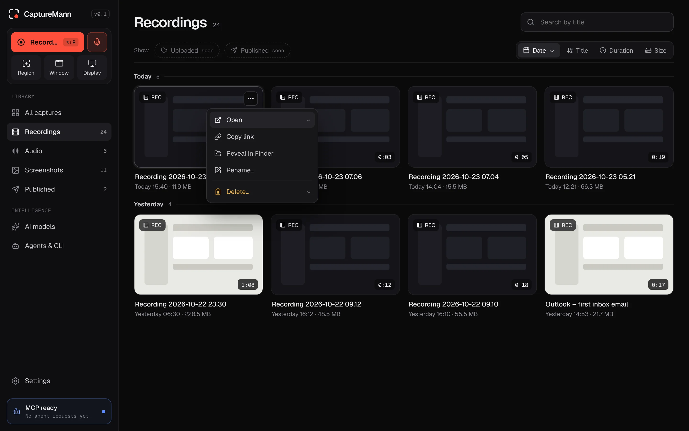
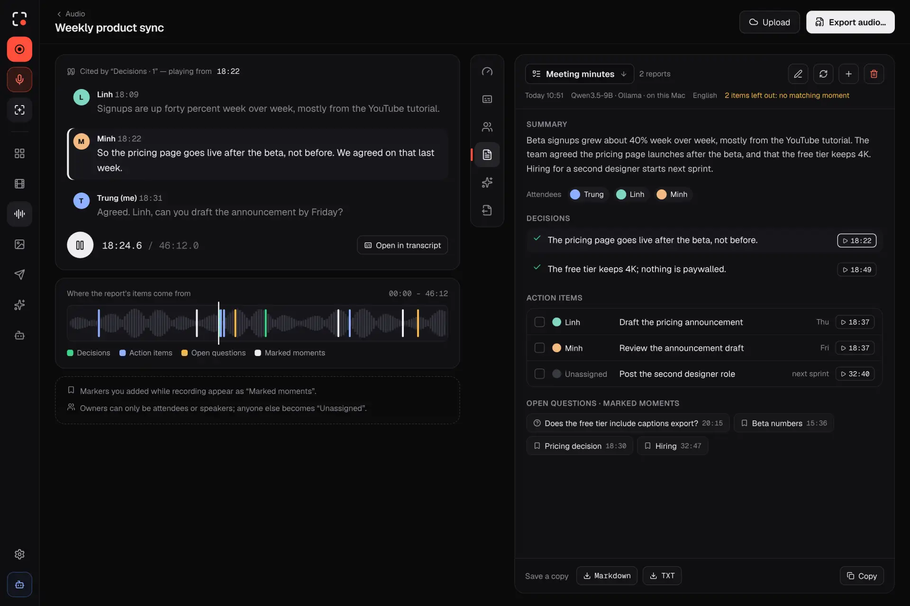
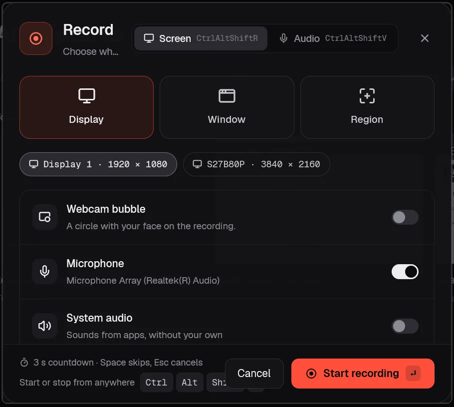
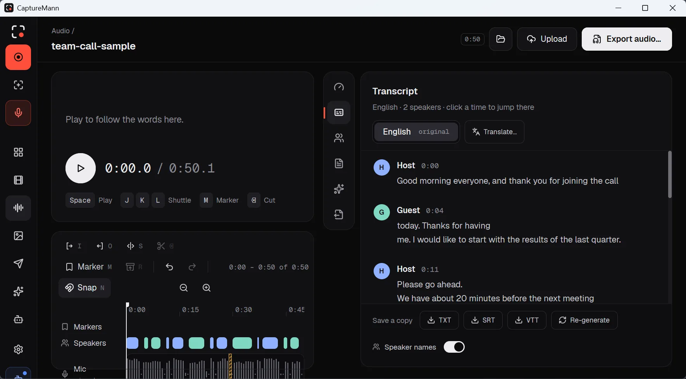

<h1 align="center">
  <picture>
    <source media="(prefers-color-scheme: dark)" srcset="design/brand/logo/svg/lockup-horizontal-on-dark.svg">
    
  </picture>
</h1>

<p align="center">
  <a href="https://www.craftmann.app/"></a>
</p>

<p align="center">
Free, open-source screenshots, screen recording and audio recording, with local AI captions,<br>
transcripts, meeting minutes and speaker labels, and every feature available to AI agents<br>
through MCP and a CLI.
</p>

<p align="center">
<a href="https://github.com/craft-mann/capturemann/actions/workflows/ci.yml"></a>
<a href="LICENSE"></a>
<a href="https://github.com/craft-mann/capturemann/releases/latest"></a>


</p>

<p align="center">
  
</p>

## Features

✓ works, — not available. Notes in brackets name the limit. Current versions and downloads are on the
[releases page](https://github.com/craft-mann/capturemann/releases/latest); what each platform has been tested on is
in the release notes and in [`verification/`](verification/).

| Feature | macOS | Windows | Linux |
| --- | :---: | :---: | :---: |
| **Screenshots** of a display or a region, with an annotation editor | ✓ | ✓ | ✓ |
| Window screenshots | ✓ | ✓ | ✓ [Wayland: through the desktop's own picker] |
| **Auto-redact** of personal data and secrets in screenshots (see below) | ✓ | ✓ | ✓ [uses the system `tesseract`] |
| **Copy text** from a screenshot (on-device text recognition; reads the rendered image, so blurred text is not copied) | ✓ | ✓ [reads the OCR languages installed in Windows] | ✓ [uses the system `tesseract`, English unless more language data is installed] |
| **Screen recording** (display, up to native resolution, 30 or 60 fps), pause, resume, crash recovery | ✓ | ✓ | ✓ [GNOME records without the share dialog; other desktops ask through the portal] |
| Window and region recording | ✓ | ✓ | ✓ [window recording on X11 only] |
| Microphone (noise suppression) and system audio | ✓ | ✓ | ✓ |
| Webcam track and live webcam bubble while recording | ✓ | ✓ | ✓ [camera track; no live bubble] |
| Cursor telemetry (restylable cursor, auto-zoom) | ✓ | ✓ | ✓ [X11 only] |
| Global shortcuts | ✓ | ✓ | ✓ [X11 only] |
| **Editor**: trim, cut, split, speed, backgrounds, zoom regions, 9:16 and 1:1 reframe | ✓ | ✓ | ✓ |
| Export to MP4, platform presets, GIF or WebM | ✓ | ✓ | ✓ [H.264 with a hardware encoder, else labelled VP9] |
| Import MP4, MOV, MKV and other formats, and PNG and JPEG pictures | ✓ | ✓ | ✓ |
| **Audio recording** (meetings, lectures, voice notes), audio editor, export to M4A or WAV | ✓ | ✓ | ✓ |
| **Local AI**: Whisper transcripts and captions (SRT, VTT, TXT, burned in), caption editor, translation | ✓ | ✓ | ✓ |
| **Speaker labels**: who spoke when, with rename and merge | ✓ | ✓ | ✓ |
| **Meeting minutes and reports** by a built-in text model (no cloud, no account) | ✓ | ✓ | ✓ |
| **Library** of self-contained capture bundles, in a folder you choose | ✓ | ✓ | ✓ |
| **Share**: local folders, Google Drive, YouTube (private by default) | ✓ | ✓ | ✓ [not run on Linux yet] |
| **For agents**: 81 MCP tools plus resources and prompts, and an identical `capturemann` CLI; risky actions need an on-screen confirmation | ✓ | ✓ | ✓ |
| Secrets stored in the system keychain | ✓ [Keychain] | ✓ [Credential Manager] | ✓ [Secret Service, else an owner-only file] |
| Install through an APT repository | — | — | ✓ |
| English and Vietnamese interface | ✓ | ✓ | ✓ |

Models download only when you press Download. Speaker labels run on two small models that ship inside the app; tell
the app which languages you speak (for example `vi, en`) so a short recording is not heard as a related language.
**Private by design:** no telemetry, and no network traffic unless you connect a destination or download a model; you
bring your own Google credentials. Actions of a recording that start, publish or delete need your confirmation.

<p align="center">
  
</p>

## Long recordings: how they are transcribed, and what it costs

A meeting of two or four hours is not sent to the speech model in one piece. The app decodes the audio once, then
reads it **piece by piece** (about 5 minutes each, cut at a quiet point near the target) as a background job:

- **Each piece is its own run.** A loop of the same sentence (a known Whisper failure on long audio) cannot pass a
  piece boundary; every piece is checked for loops, and one that loops is cut in half and read again.
- **Checkpoint after every piece.** If the app quits, the computer sleeps or a recording starts (the job holds
  while you record), the job goes on from the last finished piece, not from the start.
- **Results show up while the rest is made** (0.3.1): the finished minutes are readable in the transcript and
  follow the playback line at once, marked as partial; captions, speakers and reports wait for the end. The CLI and
  the MCP tool return the same partial transcript (`partial: true`, `covered_secs`, `total_secs`).
- **Speakers are one pass over the whole file**, so "Speaker 2" is the same person in hour 1 and hour 3.
- Everything runs on your computer; nothing is uploaded.

What it cost on one computer (Apple M4 Pro, 48 GB, Metal, model large-v3, an imported MP3 each; 0.3.1 dev build; one run
per row, so read them as examples, not as a guarantee):

| File | Audio | Time to transcribe | Speed | Memory (peak) | Result |
| --- | --- | --- | --- | --- | --- |
| English meeting | 2 h 07 min | 25 min | 5.1 times real time | 4.1 GB | 17,324 words, 5 % of words under 0.6 confidence, no crash |
| Vietnamese meeting, speakers at the same time | 4 h 14 min | 85 min | 3.0 times real time | 4.3 GB alone, **11.7 GB** with the speaker job | 41,060 words, 25 % under 0.6 confidence, no crash |

Full reports, with progress and memory over time and what was not measured:
[`long-audio-transcription-large-v3-m4pro-2026-11-10.md`](verification/benchmarks/long-audio-transcription-large-v3-m4pro-2026-11-10.md)
and
[`long-audio-transcription-vietnamese-4h13-large-v3-m4pro-2026-11-10.md`](verification/benchmarks/long-audio-transcription-vietnamese-4h13-large-v3-m4pro-2026-11-10.md).

**Known limits.** Memory is not flat yet: the whole file is decoded into memory (about 1 GB per 4 hours on top of the
model), and the speaker job at the same time more than doubles the peak, so on a 16 GB computer run the speakers after
the transcript. Vietnamese with large-v3 is much less confident than English; the Vietnamese-specific models
(PhoWhisper) or a re-read of doubtful stretches help, and word times are stacked in some places. These numbers are from
one Mac: Windows and Linux have not been measured on a long file.

## Find personal data before you share a screenshot

**Auto-redact** reads the text in a screenshot with the recognizer built into your Mac (Apple Vision) and
**proposes** blur rectangles over the personal data and secrets it finds. You review the proposals
(masked previews, dashed boxes) and accept them one by one or all at once; **nothing is applied
automatically**. It runs on your computer and uses no network. The same function is available to agents
(MCP `suggest_redactions`, which only proposes) and to the command line
(`capturemann annotate <id> --suggest-redactions`). The user guide has the details:
[Auto-redact](docs/user/redaction.md).

It finds **formats and checksums**, not meaning: a payment card number (Luhn check and issuer prefix), a
Social Security number in an issuable range, a routing number with a valid checksum, a private-key block, a
`PASSWORD=...` line. It does not find names, addresses or dates. The kinds, generated from the rule data
(a test fails when this table and the code differ):

<!-- redaction-kinds:start -->
| Kind | Group | What it finds | Standards that name it | On by default | Check used |
|---|---|---|---|---|---|
| `email` | Contact | Email addresses (`local@domain.tld`). | HIPAA 6 | yes | Shape only |
| `token` | Credentials and secrets | API keys, JWTs and other long random-looking strings: known provider shapes, or a mix of 24 or more letters and digits (lower confidence). | GLBA / state breach laws (credentials) | yes | Known prefix and length, or letter-and-digit mix |
| `private_key` | Credentials and secrets | PEM private-key blocks, every line from the BEGIN line to the END line. | GLBA / state breach laws (credentials) | yes | BEGIN and END lines |
| `secret_assignment` | Credentials and secrets | The value in `NAME=value` or `"name": "value"` pairs whose name looks secret (password, token, key and similar). | GLBA / state breach laws (credentials) | yes | Secret-looking name, value is not a placeholder |
| `url_secret` | Credentials and secrets | A password inside a URL, or a secret value in a URL query string. | HIPAA 14; GLBA / state breach laws (credentials) | yes | Userinfo password or secret-looking parameter name |
| `card` | Payment cards | Payment card numbers of 13 to 19 digits; masked numbers are skipped. | PCI DSS; HIPAA 10; GLBA | yes | Luhn + issuer prefix + length |
| `card_extra` | Payment cards | An expiry date or security code beside a detected card number (found by position, no label needed). | PCI DSS (sensitive authentication data) | yes | Valid month, or 3 or 4 digits, beside a detected card |
| `ssn` | Identity and tax numbers | US Social Security numbers written `NNN-NN-NNNN` or with spaces; masked forms and bare nine-digit numbers are skipped. | NIST SP 800-122; HIPAA 7; GLBA | yes | Issuable ranges (no 000, 666 or 9xx area, no 00 group, no 0000 serial) |
| `itin` | Identity and tax numbers | US Individual Taxpayer Identification Numbers (`9NN-NN-NNNN` with an ITIN group). | NIST SP 800-122; HIPAA 7; GLBA | yes | ITIN group ranges |
| `ein` | Identity and tax numbers | US Employer Identification Numbers (`NN-NNNNNNN`). | NIST SP 800-122 | yes | Valid prefix |
| `aba` | Bank accounts | US bank routing numbers (nine digits). | HIPAA 10; GLBA | yes | Checksum + prefix range |
| `iban` | Bank accounts | International bank account numbers, solid or in groups of four. | HIPAA 10; GLBA | yes | Mod 97 |
| `npi` | Health identifiers | US National Provider Identifiers (ten digits). | HIPAA 11 | no | Luhn with the 80840 prefix |
| `dea` | Health identifiers | US DEA registration numbers (two letters, seven digits). | HIPAA 11 | yes | Check digit |
| `mbi` | Health identifiers | US Medicare Beneficiary Identifiers (11 characters). | HIPAA 9 | yes | Position rules for each character |
| `passport` | Identity and tax numbers | US passport book numbers written as a letter and eight digits. | HIPAA 11; GLBA | yes | Letter + eight digits |
| `vin` | Devices and networks | Vehicle identification numbers (17 characters). | HIPAA 12 | yes | Check digit at position 9 |
| `imei` | Devices and networks | Mobile device IMEI numbers (15 digits). | HIPAA 13 | yes | Luhn |
| `ip_address` | Devices and networks | IPv4 and IPv6 addresses; loopback and unspecified addresses are skipped. | HIPAA 15 | yes | Valid address syntax |
| `mac_address` | Devices and networks | MAC addresses (six hex pairs). | HIPAA 13 | yes | Six hex pairs, one separator style |
| `phone` | Contact | Phone and fax numbers of 10 to 15 digits with separators or a leading `+`, extensions included. | HIPAA 4, 5 | yes | NANP rules for US numbers; separators or `+` required |
<!-- redaction-kinds:end -->

The "Standards that name it" column maps each kind to the public lists that mention that kind of data
(NIST SP 800-122, HIPAA Safe Harbor identifiers, PCI DSS, GLBA and state breach-notification laws). **This
is a mapping of kinds, not a compliance claim: CaptureMann is not a compliance tool, and using it does not
make a screenshot compliant with any of them.**

### How well it works (measured, synthetic data)

All numbers below come from a stored report and are measured on **synthetic screenshots made by this project**
(300 images, fixed seed 20261030, 13 screen layouts, light and dark, 1x and 2x, some degraded): 211 images from
9 layouts (`dev`, where the rules were tuned) and 89 images from 4 other layouts (`held_out`, read once after
everything was fixed). The images contain made-up data whose formats the rules know, so these figures are an
upper bound for real screenshots, not a measure of real-world accuracy. Recognizer: Apple Vision, on an Apple
M4 Pro, macOS 26.6.2. Date: 2026-10-30.

| Apple Vision, synthetic | dev: 0.2.3 (4 kinds) | dev: 0.2.5 | held-out: 0.2.3 | held-out: 0.2.5 |
|---|---|---|---|---|
| Items scored | 1,367 | 2,275 | 436 | 1,410 |
| Found (any kind) | 92.2 % | 95.3 % | 94.5 % | 98.6 % |
| Precision (proposals that were real items) | 68.8 % | 92.0 % | 69.2 % | 94.4 % |
| False alarms per image | 2.725 | 0.417 | 2.056 | 0.831 |
| False alarms per image with nothing to find | 2.000 | 0.746 | 2.074 | 0.889 |
| Leak rate (still readable after the blur) | 4.2 % (58 of 1,367) | 2.1 % (47 of 2,275) | 3.4 % (15 of 436) | 0.5 % (7 of 1,410) |

The old and new columns score different sets of items (the old detector knew 4 of the 20 default kinds), so the
"found" rows are not like for like. With perfect text instead of Apple Vision (this separates rule errors from
recognizer errors) the 0.2.5 rules find 99.2 % at 98.5 % precision on `dev` and 100 % at 95.9 % on `held_out`.
Report: [0.2.5 final run](verification/benchmarks/redaction-0.2.5-final-2026-10-30.md) (it includes the 0.2.3
detector on the same held-out layouts), with the earlier
[0.2.3 baseline](verification/benchmarks/redaction-0.2.3-baseline-2026-10-30.md) and
[interim 0.2.5 run](verification/benchmarks/redaction-0.2.5-dev-2026-10-30.md); per-kind, per-layout,
per-font-size and per-language tables and the lookalikes that raised false alarms are in them.

What the numbers say plainly. The **false-alarm target is not met**: the goal was below 0.2 false alarms per
image with nothing to find and 0.2.5 shows 0.746 (`dev`) and 0.889 (`held_out`). The generic long-token rule
(unchanged from 0.2.3 and kept on) is the main cause, for example by proposing full git hashes. `npi` is **off by
default** because only 30 % of its proposals were real. Private-key blocks are the weakest default kind with
Apple Vision (65.5 % of key lines covered, 15.5 % still readable after the blur, `dev` only: the held-out layouts
contain no keys or secret URLs). Nothing here has been checked on real screenshots yet (that is the
maintainer's manual cross-check, [`tests/manual/RED-1.md`](tests/manual/RED-1.md)).

To reproduce on your own Mac (builds the synthetic set from the seed, no network; `run` uses the system
recognizer):

```sh
cargo run -p cm-render --example redaction_bench --release --locked -- gen --out /tmp/redaction-set
cargo run -p cm-render --example redaction_bench --release --locked -- run --set /tmp/redaction-set --detector-only --split dev
cargo run -p cm-render --example redaction_bench --release --locked -- run --set /tmp/redaction-set --recognizer system --split dev
```

### What it does not do

- It finds **formats and checksums only**. Names, street addresses and dates are not found, and there are no
  label-based kinds: a CVV or an expiry date with no card number on the screen is not proposed, and a bare
  value under a "Password" or "SSN" label is not found by the label (a `NAME=value` pair with a
  secret-looking name is).
- **Text the recognizer cannot read stays.** Small, low-contrast or unusual text can be missed, which is what
  the leak rate measures. Private-key blocks are the weakest default kind with Apple Vision.
- Bare ten-digit Vietnamese mobile numbers (`0934851497`) are not found, and passwords made only of letters
  (`letmein`) are not proposed.
- Some lookalikes are proposed anyway (in the dev split: hash strings, timestamps, ten-digit ids, tracking
  numbers); that is why you review.
- On **Windows** Auto-redact uses the recognizer built into Windows (0.2.8); on **Linux** it uses the system `tesseract` program (recall is lower than Apple Vision's). The numbers below are for Apple Vision on macOS only; neither of the others has been measured.
- It is not a compliance tool. **A blurred screenshot is not proof that nothing sensitive remains**: look at
  the result before you share it.

## How it compares

Side-by-side pages, with sources and where the other tool is the better choice:
[Loom](compare/loom.md), [Snagit](compare/snagit.md), [CleanShot X](compare/cleanshot-x.md), [Cap](compare/cap.md),
[Screen Studio](compare/screen-studio.md), [ShareX](compare/sharex.md), [OBS Studio](compare/obs-studio.md),
[Camtasia](compare/camtasia.md), [Descript](compare/descript.md) and [Otter.ai](compare/otter.md). Start at the
[overview](compare/README.md). Checked on Nov 11, 2026; competitor details change, so their own sites are the current
source.

## Install

Pick your system: [macOS](#macos) (below), [Windows](#windows) or [Linux](#linux).

### macOS

Requires a Mac with macOS 13 or later, Apple Silicon or Intel (Apple menu > About This Mac shows the chip). There is one download per chip. **The Intel build (0.2.1 and later) is built and checked on Apple Silicon.** It installs and opens on a real Intel Mac, but starting a screen recording crashed a MacBook Pro 16" 2019 in 0.2.2 ([issue 16](https://github.com/craft-mann/capturemann/issues/16)); 0.2.3 catches the error and retries with simpler settings, which is not confirmed on that Mac yet. The speech and text models may be slow on older Intel Macs. Please report problems. The app is about 180 MB (Apple Silicon) or 190 MB (Intel).  The AI models are not in it: they download only when you press Download (about 4.4 GB for the recommended speech model, Large v3 Turbo, plus the recommended text model, Gemma 4 E2B). The two small speaker models are inside the app.

**With Homebrew:**

```sh
brew install --cask craft-mann/tap/capturemann
```

Homebrew picks the right build for your chip. This also links the `capturemann` command line into Homebrew's `bin`. Update with
`brew upgrade --cask capturemann`.

**From the release page:**

1. Download `CaptureMann-v<version>-macos-arm64.dmg` (Apple Silicon) or
   `CaptureMann-v<version>-macos-x86_64.dmg` (Intel) and its `.sha256` file from
   [Releases](https://github.com/craft-mann/capturemann/releases).
2. Check the download (in the folder with both files):
   `shasum -a 256 -c <the DMG's name>.sha256` must print `OK`.
3. Open the DMG and drag CaptureMann to Applications.

The release DMG is signed with a Developer ID certificate and notarized by Apple, so it opens
normally. A build you make yourself from source is signed locally or ad hoc and is **not
notarized**: Gatekeeper blocks it at first launch, so right-click the app and choose Open, or run
`xattr -dr com.apple.quarantine /Applications/CaptureMann.app`. Updates are manual: download the new
DMG. The `capturemann` command line is inside the app; to use it as `capturemann`, link it once:
`sudo ln -s /Applications/CaptureMann.app/Contents/MacOS/capturemann /usr/local/bin/capturemann`.
To build it yourself instead, see [building from source](docs/development/building.md). More on verifying a
download: [docs/development/releasing.md](docs/development/releasing.md#how-users-verify-a-download).

### Windows

Windows 11 (x64). From [Releases](https://github.com/craft-mann/capturemann/releases) download
`capturemann-<version>-windows-x64-setup.exe` (a per-user installer, no administrator rights) or
`capturemann-<version>-windows-x64.zip` (unpack anywhere and run `cm-desktop.exe`; `capturemann.exe` is the command
line). Check the download with its `.sha256` file (`certutil -hashfile <file> SHA256`) or the release's `SHA256SUMS.txt`.
A winget package (`winget install CaptureMann.CaptureMann`) is submitted ([pull request](https://github.com/microsoft/winget-pkgs/pull/472327))
and works only after it is accepted.
**The files are not signed**, so Windows SmartScreen warns before the first run (More info, then Run anyway).
From 0.2.8 the Windows build records (screen, microphone, system audio, camera), and has screenshots, the editor, the
library, local AI with the speaker and text models bundled, Auto-redact with the recognizer built into Windows, the CLI
and the MCP server. It was checked on one lab laptop (Windows 11, Intel graphics), see the reports
`verification/L1-windows-0.2.8-*.md` (PARTIAL). Not tested:
Windows 10, NVIDIA and AMD hardware encoders, a second monitor with mixed scaling, SmartScreen on a real download. The
older 0.2.6 Windows files have no recording.

<p>


</p>

<sub>Screenshots from the 0.2.8 Windows build on the lab laptop, with sample content only. More are in the release notes.</sub>

### Linux

Ubuntu 24.04 or later, Debian 13, or another distribution with glibc 2.39 or newer; x86_64 and aarch64. From
[Releases](https://github.com/craft-mann/capturemann/releases):

```sh
sudo apt install ./capturemann_<version>_amd64.deb      # or _arm64.deb; Ubuntu and Debian
```

Other distributions: unpack `capturemann-<version>-linux-<arch>.tar.gz`, run `./check-runtime.sh` (it names missing
libraries), then `./install.sh`. Every file has a `.sha256` and a minisign signature
(`minisign -Vm <file> -P RWTeQv8ogB2CCuZ7j0rr3MovdHod4QATmVn+I329YC8pomOC6R9Rxc2k`; the key is
`packaging/linux/minisign.pub`). 0.3.0 works like the other systems for: screenshots (region, window and display on X11;
region, display and, through the desktop's picker, window on GNOME Wayland), screen recording (on by default; GNOME records
without a share dialog, other desktops use the portal), microphone, system audio and camera, import and export (VA-API
H.264, or labelled software VP9 without a GPU encoder), the editor, the library, local AI, Auto-redact with
`sudo apt install tesseract-ocr`, the CLI and the MCP server. Differences by design: no live webcam bubble during a take (the
camera is a track, composited at export), a banner instead of a floating HUD, no per-app exclusion; window recording, global
shortcuts and the cursor track are X11 only. Details, the list of what was not run and the known gaps are in the release
notes and in [`specs/plans/linux-parity-matrix.md`](specs/plans/linux-parity-matrix.md).

## Quick start

```sh
make run-bundle                 # builds, signs and opens target/bundle/CaptureMann.app
# the CLI and MCP server are inside the bundle, in Contents/MacOS
target/bundle/CaptureMann.app/Contents/MacOS/capturemann capture screenshot
```

Connect an AI agent over MCP (stdio):

```json
{ "mcpServers": { "capturemann": { "command": "/path/to/CaptureMann.app/Contents/MacOS/capturemann", "args": ["mcp"] } } }
```

See [`specs/02-agent-interface.md`](specs/02-agent-interface.md) for the tools, permission tiers and
the CLI.

### Claude plugin

Claude Code users can install the CaptureMann plugin, which connects the MCP server above and adds skills for
screenshots with redaction, screen recording, meeting notes and export. CaptureMann itself must be installed and
running; the plugin adds no network traffic. See [`docs/user/claude-code-plugin.md`](docs/user/claude-code-plugin.md):

```sh
claude plugin marketplace add craft-mann/capturemann
claude plugin install capturemann@capturemann-plugins
```

## Build from source

Rust 1.95, Xcode command line tools and `cmake`:

```sh
cargo test --workspace --locked
make bundle
```

Full instructions, the bundled LGPL FFmpeg and macOS permissions: [`docs/`](docs/README.md).

## Documentation

- [`docs/`](docs/README.md): building, permissions, plan, design, spikes
- [`specs/`](specs/README.md): product spec, technical design, agent interface, integrations, features
- [`CONTRIBUTING.md`](CONTRIBUTING.md), [`SECURITY.md`](SECURITY.md), [`CODE_OF_CONDUCT.md`](CODE_OF_CONDUCT.md),
  [`CHANGELOG.md`](CHANGELOG.md)

## Contributing

Contributions are welcome, especially new storage providers, publishing platforms and translations.
Read [`CONTRIBUTING.md`](CONTRIBUTING.md) first. Security problems: please report them privately, see
[`SECURITY.md`](SECURITY.md).

## Links

CaptureMann is a [CraftMann](https://www.craftmann.app/) app.
[Contact](https://www.craftmann.app/capturemann/) ·
[Privacy policy](https://www.craftmann.app/capturemann/privacy/) ·
[Source](https://github.com/craft-mann/capturemann)

## License

Apache-2.0, see [LICENSE](LICENSE). Third-party notices: [NOTICE](NOTICE) and
[THIRD_PARTY_LICENSES.md](THIRD_PARTY_LICENSES.md). The bundled FFmpeg is an unmodified LGPL build.

The Apache-2.0 licence covers the code. It does not grant rights to the CaptureMann or CraftMann names or logos (`design/brand`); forks should use their own name and marks.
