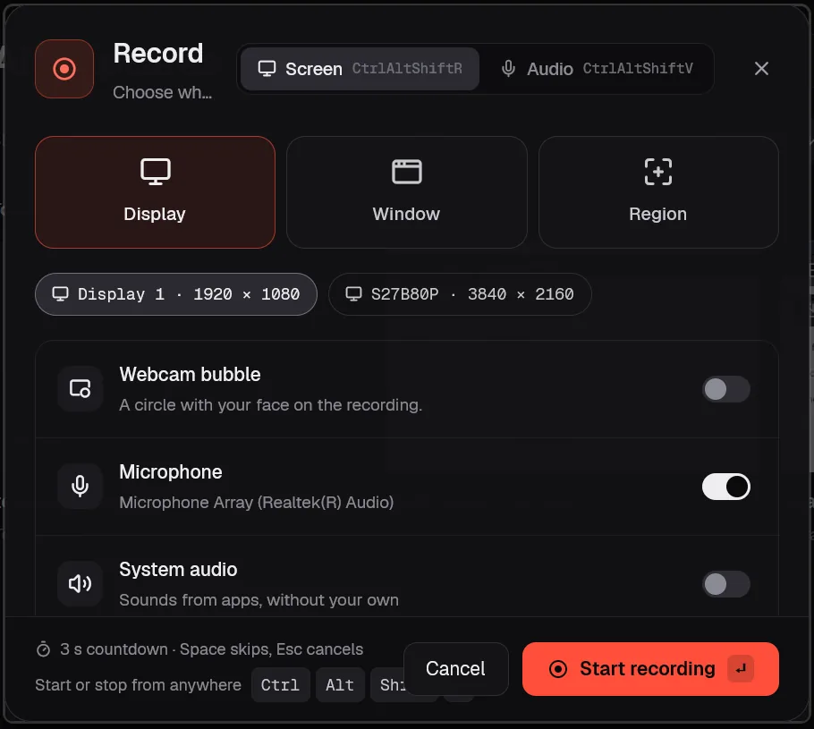
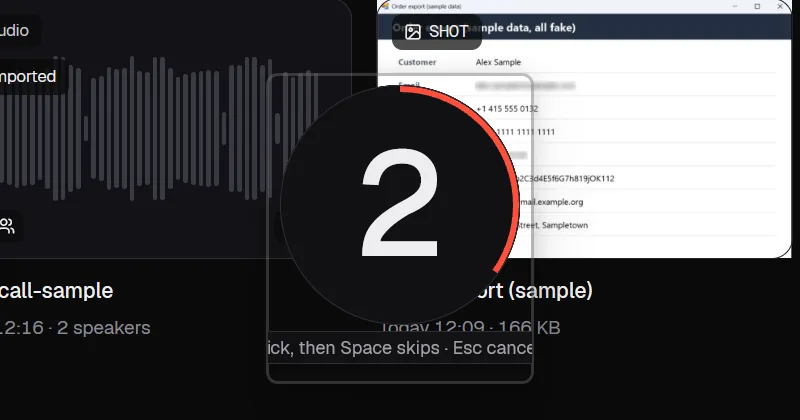
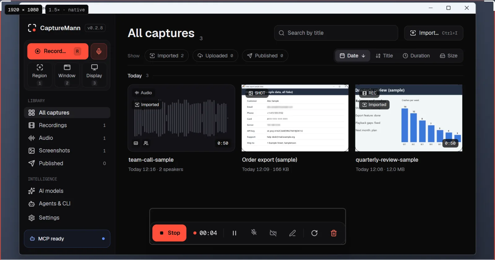
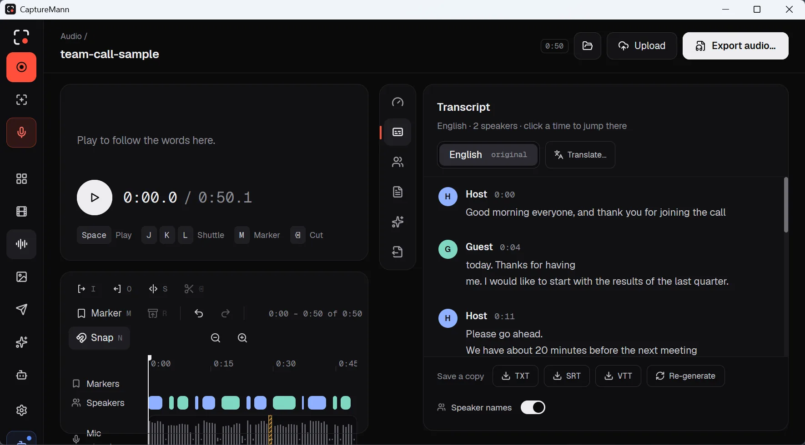
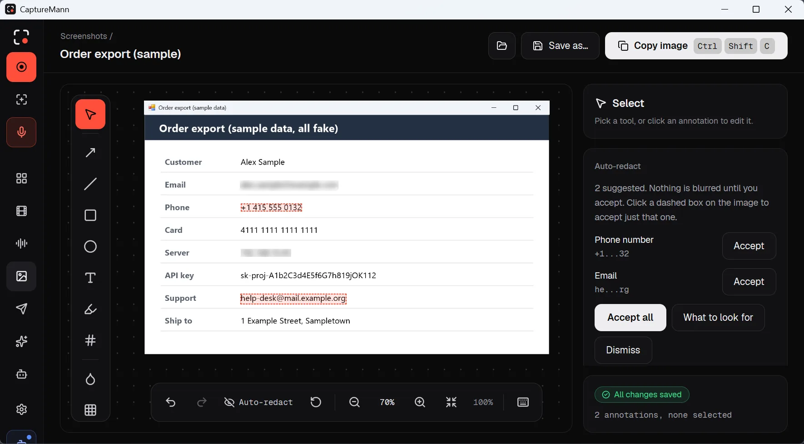
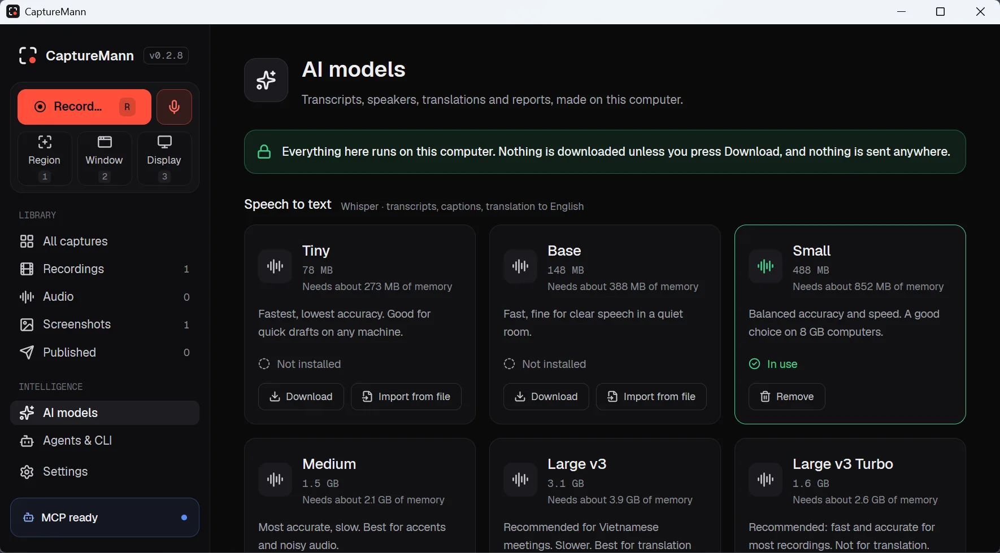
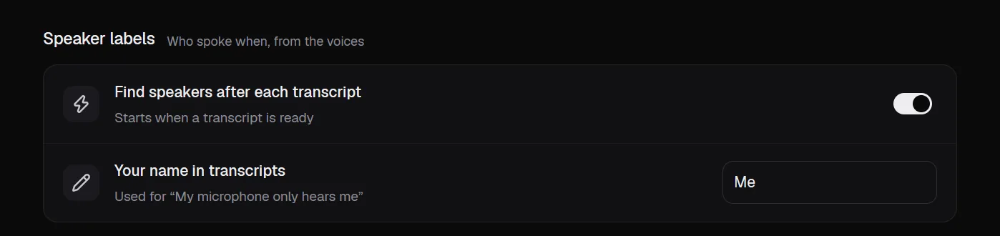
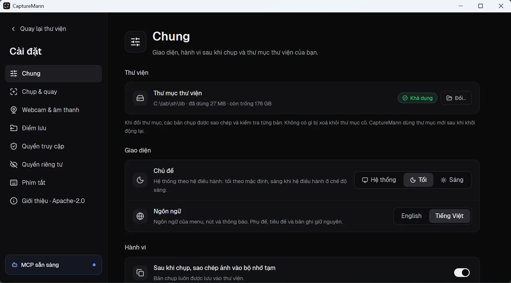
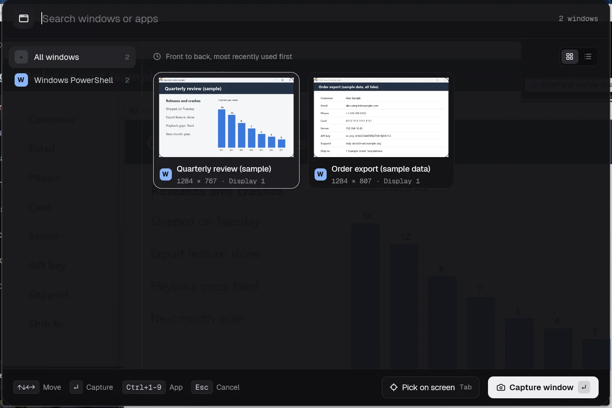

# GitHub release text for 0.2.8 (final text, not published)

Written Nov 5, 2026 from the stored reports in `verification/` (all PARTIAL: one agent, one laptop, nothing seen by a
person unless a line says so). It replaces `windows-0.2.8-release-notes-draft.md`. Paste "Release body" into the release
page. One thing is left: the winget pull request URL (after the pull request is opened). The CHANGELOG section is dated Nov 6, 2026
(change it if the release goes out on another day). The checksums are those of the files built from the tag `v0.2.8` (package run 42201119181, commit `e54cc665`). Nothing here has been
posted. Steps: `windows-0.2.8-release-checklist.md` and
`release-day-0.2.8.md`.

- **Tag:** `v0.2.8` (never reuse a tag). **Title:** `CaptureMann 0.2.8: recording comes to Windows`.
- **Type:** draft, then **pre-release** (the version is 0.x).
- **Files to attach:** `capturemann-0.2.8-windows-x64-setup.exe`, `capturemann-0.2.8-windows-x64.zip`, their two
  `.sha256` files and `SHA256SUMS.txt` (made by `packaging/windows/release-files.sh`). Windows files are not signed
  (decision O4, Nov 5, 2026). No macOS or Linux files are attached (decided Nov 6, 2026: 0.2.8 is Windows only); the
  shared changes below reach the Mac and Linux with their next builds (0.3.0 is Linux).

---

## Release body

# CaptureMann 0.2.8: recording comes to Windows

The Windows build now **records**: the screen, the cursor, the microphone, system audio and the camera. It also imports
video and audio, exports with a bundled FFmpeg, finds sensitive text with the recognizer built into Windows, and ships the
speaker engine and the local text engine. Windows 11 (x64) is a supported release from this version. It was tested on **one laptop** (a Lenovo
ThinkPad T490, Intel UHD 620 graphics, Windows 11; Windows 10 and other graphics hardware were not tested), the limits are listed below, and the files are **not signed**.

## What is new on Windows

- **Recording** of a display, a window or a region, with the cursor, microphone, system audio and camera; pause and
  resume; a crash or a killed process leaves a recording that is recovered at the next start. The screen is captured with
  Windows.Graphics.Capture and encoded by the Media Foundation hardware H.264 encoder.
- **System audio** through WASAPI process loopback, which leaves out CaptureMann's own sound on a recent Windows 10 or 11
  (older versions fall back to the plain loopback, which includes it).
- **Import** of video and audio files (editing copies are made by the hardware H.264 transform).
- **Export** with the bundled LGPL FFmpeg 9.0.2: the quick export, the YouTube 1080p preset, vertical, square, WebM and GIF.
  H.264 files are tagged BT.709.
- **Auto-redact** with `Windows.Media.Ocr`: no extra program to install. It reads the languages installed in Windows.
- **Speaker labels** (sherpa-onnx engine) and **local transcription and the built-in text model** (whisper.cpp built for a
  portable AVX2 CPU, `llama-server` v0.7.0, the same pin as on macOS). The two speaker-label models are bundled
  (`Resources\Models\speaker`; pyannote segmentation-3.0, MIT, and CAM++ from 3D-Speaker, Apache-2.0; about 35 MB; the
  licences and notices ship with them). Speech models are downloaded or imported by you, as on the Mac.
- **Installer** (per user, no administrator rights) and the zip; the `capturemann` command line and the `cm-mcp` server.
- **Names and sizes that were wrong in 0.2.6** are fixed: displays are named ("Display 1", not "Unknown Monitor 65537"),
  packaged apps show their real names (Notepad, Settings, Windows Terminal), and a window screenshot has the size the picker
  listed (the app now runs per-monitor DPI aware). The interface uses Windows' own words (File Explorer, Recycle Bin,
  Credential Manager, notification area).
- **Diagnostics** (`capturemann diagnostics`) lists the Windows build, each graphics adapter with its driver, the recognizer,
  FFmpeg, `llama-server` and the speaker engine, and says what this build includes.

## What it looks like

<!-- The images below are in docs/images/windows/ on the Windows track and reach `main` with the merge; the release text
     refers to them by their raw GitHub address on `main`, so they only show once the merge is done. All were taken on
     the lab ThinkPad T490 (Windows 11, package 0.2.8) with a private library and made-up content only: generated sample
     pages, a synthetic voice clip (two Windows text-to-speech voices), no real names, accounts or recordings. -->

Screenshots of the 0.2.8 Windows build on the test laptop. Everything on screen is sample content made for this page.

**Start recording.** The start sheet lists every display (here the laptop panel and an external 4K monitor), and has
switches for the webcam bubble, the microphone and system audio.



**Countdown and recording bar.** A 3-second countdown appears on the display being recorded, then the bar with Stop,
the timer, pause, microphone, camera, pen, restart and discard.





**Transcript with speaker labels.** A 50-second clip of two synthetic voices, transcribed on the laptop with the `small`
model and labelled by the bundled speaker models (renamed Host and Guest). On this clip one boundary between the voices
is off by a few words, which is why the labels can be corrected by hand.



**Auto-redact.** On a sample page full of made-up personal data, Auto-redact found four items with the recognizer built
into Windows (two e-mail addresses, a phone number and an IP address). Two are accepted and blurred here; nothing is
blurred until you accept it. It did not flag the sample card number or the sample key on this page: the recognizer
finds what it can, so check the result before you share an image.



**Speech models and speaker labels.** The AI page lists the Whisper speech models (here `small` is installed and in
use) and the speaker-label settings. The two speaker-label models are inside the Windows package, so nothing has to be
downloaded for them.





**Vietnamese interface.** Settings, General, with the language set to Tiếng Việt. The full interface text was reviewed
by the maintainer (see the limits above for the 86 draft entries).



**Window picker.** Pick a window to capture from a list with live thumbnails, or search by name. The region picker
was not captured for these pictures.



## Also in this release (all platforms; the Mac and Linux get it with their next builds)

- Two new agent tools, with CLI commands: `get_cursor_track` (`capturemann cursor`) and `get_platform_rules`
  (`capturemann platform-rules`). The MCP server now lists 79 tools.
- `capturemann settings set` is followed by the running app at once (a `settings.changed` event), and the capture delay is
  read for each capture.
- A recording whose encoder cannot keep up is marked with an `encoder_overloaded` warning in its manifest, and the drop
  counters are honest; a recording area that is too small is `invalid_input` (`recording_area_too_small`), not a missing
  encoder; the daemon publishes `camera.reconnected` when a camera comes back.
- Error and help texts name your system (Windows, Linux or Mac) instead of always saying "Mac".

## Fixes found on the test laptop

Transcription was 10 times too slow because the speech engine was compiled without optimisation (50 s of speech took 5 to 6
minutes, now about 21 s with `small`); "Transcribe" crashed the app on a CPU without AVX-512 (the engine is now built for a
portable AVX2 baseline); a folder of speaker models was taken for a speech model by `ai transcribe` when no speech model was
installed (it answers `no_model` again); a microphone that delivers only silence is now reported after 4 s instead of 15 s;
the smallest recording area is 18 px, as 16 and 17 px made the hardware encoder refuse to start; every recording ended in a crash at stop (a stop that ran twice); the app panicked at start (a named pipe created outside a
runtime); Quick Sync refused the video format used for import copies and exports (NV12 is used now); a slowly changing screen
was reported as 54 % late frames; the area window swallowed clicks meant for the recording bar (it is click-through now); the
countdown, bar and area appear on the monitor being recorded; the window picker and the helper overlay end themselves
when the app is gone; `settings set` did not reach the running app; "Microsoft Basic Render Driver" was shown as
"Basic [redacted] Driver" in diagnostics; the Windows Terminal showed as "Windows Terminal Host"; helper programs no longer
open a console window; the CLI no longer hangs when it starts the daemon.

## Known limitations

- **Not run:** Windows 10 22H2; a second monitor with mixed scaling (steps in `tests/manual/DPI-WIN.md`); SmartScreen on a
  real browser download.
- **Hardware:** tested on one ThinkPad T490 with an Intel UHD 620 only. **NVIDIA and AMD hardware encoders and drivers are
  untried.** A computer without a hardware H.264 encoder cannot record (the message says so).
- **Camera:** replugging a camera into a **different USB port** may give it another device id; the recorder reopens the same
  id only, so it may not resume. In a dark room the camera may drop its frame rate (10 fps in a dark room, 29.8 to 30.0 fps at
  720p in a lit room).
- **Second monitor:** on a 3840x2160 monitor at 150 % next to the panel, screenshots and a 10 s recording matched the listing
  and the window picker works on both monitors. The launcher and the start sheet always open on the primary display, and the
  recording bar and the camera bubble cannot be dragged or snapped on Windows. A 4K recording on the UHD 620 could not keep
  up in an earlier test; in the final run a 30 s 4K recording of the external monitor passed the suite (full length or full 30 fps; it carries an `encoder_overloaded` warning when the encoder falls behind).
- **Smallest recording area:** 18 px per side (16 failed on the test laptop's encoder). Other GPUs may need more.
- **Sound and picture timing:** the recorded system audio lands about 15 to 35 ms after the picture in the best test, but
  that test cannot separate the product from its own stimulus, so "within 40 ms" is **not shown**. Microphone timing was not
  measured.
- **Text recognition:** only languages installed in Windows are recognized; en-US was the one checked.
- **Transcription:** CPU only (no GPU path on Windows). On the test laptop 50 s of speech took about 21 s with the `small`
  model and about 77 s with `medium` (`verification/L1-windows-whisper-speed-3-2026-11-06-claude.md`; the same clip took
  5 to 6 minutes before the speech engine was built with its optimisation flags). The two speaker model files are bundled in the package and found without importing (`capturemann diagnostics` says
  "bundled with this build"). Two synthetic voices were separated when the count was given, and merged into one when it
  was left to "auto".
  **An invented outro-style sentence over quiet stretches is still a known fault** (see the 0.2.7 notes and
  `ai.transcribe_raw_mic`): no transcription mitigation is part of this release.
- **Playback follows Windows' default output device.** The editor plays on the device Windows has selected. When a monitor
  with its own audio is connected, Windows may make it the default and the sound goes there; choose your speakers in Windows
  Settings, System, Sound. An output-device choice inside CaptureMann is not part of this release.
- **Region picker:** it could not be seen or driven by the automated runs (the window picker was looked at by the
  maintainer on both monitors).
- **Vietnamese:** the full Vietnamese interface text was reviewed by the maintainer on Nov 6, 2026, except 86 entries (new Windows and Linux wording) that are still marked as drafts.
- **Not signed** (see Install).

## Install

Windows 11, x64. Windows 10 (22H2) is listed as supported but has not been tested on a real device yet; all testing so far was on Windows 11 with an Intel processor.

- **Installer** `capturemann-0.2.8-windows-x64-setup.exe` (per user, no administrator rights). SHA-256 `a10f52729bf3b5d9c8ebb44b0b96d0fc7441580f16615efccc5c32473860f0f7`
- **Zip** `capturemann-0.2.8-windows-x64.zip`: unpack anywhere and run `cm-desktop.exe`; `capturemann.exe` is the command line.
  SHA-256 `5169e7ebdc5d8d0c34ac5b20f32913fc5267538bced5d5b6af414c12eda1fdcd`
- **winget** (once the package is accepted): `winget install CaptureMann.CaptureMann` (pull request: `<winget pull request URL>`; add this line to the release only after it is merged)
- Check a download: `certutil -hashfile <file> SHA256` and compare with the sum above (or `SHA256SUMS.txt`).

**Windows may show a SmartScreen warning for a file downloaded in a browser**, because the files are not code-signed
(decision of Nov 5, 2026: no signing while CaptureMann is 0.x). Choose **More info, then Run anyway**. Installing with winget
normally avoids it.

## How it was tested

- GitHub's `windows-latest`: build, the package, a smoke script, silent install and uninstall
  (`verification/L1-windows-package-ci-2026-11-01-claude.md`, PARTIAL).
- One ThinkPad T490 (Intel UHD 620, Windows 11 build 26200), driven by an agent over ssh and the desktop session, with the
  release regression suite `cm-regress` on the release candidate (package run 42160646234, commit `eb3cb47c`; the released files were built later from the tag, commit `e54cc665`, which adds the Vietnamese wording and fixes in the diagnostics text, the Recycle Bin wording and tests; the same suite was then run on those exact files (`...-regression-{standard,hardware}-rebuilt-*`, PARTIAL): standard 49 of 49; hardware 60 passed, 1 failed, 6 skipped of 67 on one monitor, the failure being the camera case in a dark room (10.5 fps; it passed when rerun alone in a lit room, `...-hardware-rebuilt-camera-*`), the skips needing the second monitor, the installer file or a soak time;
  reports `verification/L1-windows-0.2.8-regression-*-final-*`, all PARTIAL): smoke tier 13 of 13 passed, standard tier
  49 of 49, hardware tier 64 passed, 2 failed, 1 skipped of 67. The two failures were bugs in the test suite (it compared a
  recording with the display size times the scale, but Windows lists physical pixels; the recordings matched the displays
  exactly) and are fixed in the suite; a rerun of those two cases on the same install passed (`...-hardware-final2-*`, the
  4K external monitor and each monitor, both monitors connected). The skipped case was the speaker labels with the
  bundled models; a later suite run on the same install passed it, with `ai.transcribe` and `ai.no_model`
  (`...-hardware-final3-*`: two speakers found with the bundled models, no import). Earlier work on one laptop: a 621 s run with screen, microphone, system audio, camera and cursor at 1080p30
  (0.011 % late screen frames, keyframes every 2.0 s, about 5.5 % of the machine's CPU), `kill -9` recovery, and
  transcription on synthetic speech (`verification/L1-windows-0.2.8-*`).
- The maintainer looked at the Transcribe button by hand and saw nothing odd in a quick look (not a stored test).
- Sound and picture timing: an estimate from a flash-and-beep test of 28 to 37 ms with an uncertainty of 10 to 20 ms; it was not confirmed
  with a phone camera, so no 40 ms claim is made.
- Not tested: Windows 10, ARM, mixed-DPI second monitor, SmartScreen on a real download, NVIDIA or AMD graphics.

Report problems at the issue tracker with the output of `capturemann diagnostics`.

## Licences

Apache-2.0. The packages carry `THIRD_PARTY_LICENSES.md`. FFmpeg is an LGPL build (no GPL code, no libx264); its source
offer is in the package.

---

## Optional: CHANGELOG section (only if `release.yml` is used for a macOS build in the same tag)

```
## [0.2.8] - 2026-11-06

0.2.8 is the Windows release: recording, import, export, Auto-redact, speaker labels and the text engine on Windows
(Windows 11 x64, unsigned, tested on one laptop). macOS and Linux get the shared changes below with their next builds.

### Added
- Windows: recording of screen, cursor, microphone, system audio and camera; Import; export with a bundled LGPL FFmpeg;
  Auto-redact with Windows.Media.Ocr; speaker engine and `llama-server`; NSIS installer and zip.
- MCP tools and CLI commands `get_cursor_track` (`capturemann cursor`) and `get_platform_rules` (`capturemann platform-rules`).
- `settings.changed` and `camera.reconnected` events; `encoder_overloaded` recording warning.
- `cm-regress`, a release regression suite that drives the shipped package.

### Changed
- Messages and help use the system's own words (Windows, Linux, Mac).
- A recording area that is too small is `invalid_input` (`recording_area_too_small`).

### Fixed
- See the Windows release text: stop crash, start-up panic, Quick Sync format, late-frame count, HUD clicks, monitor placement,
  window size at 150 % scaling, display and app names, console windows, CLI hang.
```
