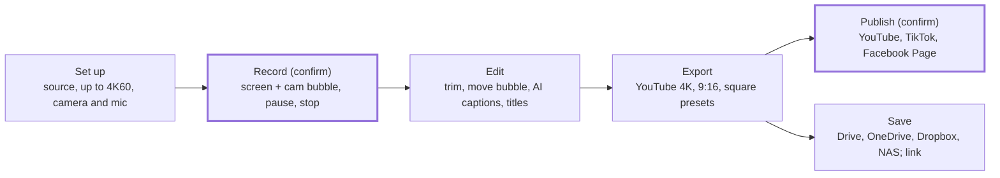

# CaptureMann — Product & Technical Spec v0.1

Oct 19, 2026

CaptureMann v0.1 is a free, open-source (Apache-2.0) desktop app for macOS on Apple Silicon (Intel Macs, then Windows, then Linux follow after v0.1, maintainer decision Oct 24, 2026) that captures screenshots and records the screen with a webcam bubble at up to the display's native resolution, then saves to local folders or Google Drive and publishes to YouTube (OneDrive, Dropbox, TikTok and Facebook Pages follow in later releases, and contributions are welcome). Every feature is also driven by AI agents through MCP and a CLI. No feature is paywalled: no resolution cap, no watermark, no account, no time limit.

This spec builds on the [Plan & MVP](https://claude.ai/code/artifact/d4deaf8a-cc04-4937-88b2-827734d05745) and the feasibility spikes S1–S3, which passed on macOS on Oct 19, 2026. Spike results S1–S6 are in `../SPIKES.md`; build status per milestone is in the Delivery plan (status table) and per requirement in each feature file's Status field.

> **UI source of truth.** Brand and UI follow the design kit in `design/` (see `docs/development/design-surfaces.md` and `plans/design-implementation.md`). Decision numbers D1–D7 below are product decisions; the kit-related decisions OD-1 to OD-11 were decided on Oct 21, 2026 and OD-12 and OD-13 are open; all are recorded in `plans/design-implementation.md`.

## Decisions (Oct 19, 2026)

| # | Decision | Consequence |
| --- | --- | --- |
| D1 | Record at the display's native resolution, up to 4K/5K, at 30 or 60 fps, user-configurable; never a 720p cap | Hardware HEVC/H.264 encoding is required; 60 fps at 4K+ is a P1 target that depends on the machine |
| D2 | Webcam bubble (Loom-style) ships in v0.1 | Camera recorded as its own track; the bubble can be moved, resized or hidden after recording |
| D3 | Storage: local disk, external drives and NAS folders, plus **Google Drive** in v0.1 (amended Oct 23, 2026: OneDrive and Dropbox are built and tested with fakes but shown as "Coming soon", to follow user feedback or community pull requests) | Background upload queue with resume |
| D4 | Publishing to **YouTube** ships in v0.1 (amended Oct 23, 2026: TikTok and Facebook Pages are "Coming soon", to follow user feedback or community pull requests) | Users bring their own API credentials first; official audited CaptureMann apps come later |
| D5 | AI is local-first (Whisper, local LLM) with optional user API keys | All AI features are free; nothing leaves the machine unless the user adds a key or publishes |
| D6 | Agent-native: every action is available through MCP, CLI and JSON-RPC | Same action bus as the GUI; recording and publishing need user confirmation |
| D7 | Apache-2.0; no GPL code in shipped binaries | LGPL FFmpeg sidecar, hardware encoders only (no software H.264 fallback in v0.1, maintainer decision Oct 24, 2026: Macs without a hardware H.264 encoder, before about 2016, are not supported in v0.1) |

All four new capabilities are in v0.1 by choice (storage and publishing each start with one provider, see D3 and D4), which moves v0.1 from week 17 to about week 29 (see the Delivery plan tab).

## Goals, non-goals and principles

**Goals for v0.1**

1. A creator can record a 4K screen walkthrough with a webcam bubble and mic, trim it, and publish it to YouTube in under 5 minutes of their own time, at full quality.
2. A teacher can record a lesson with their face in a corner, save it to Google Drive, and share it, without paying or signing up.
3. A developer can capture, annotate and paste a screenshot in under 10 seconds.
4. An AI agent can do all of the above through MCP, asking the user only before recording or publishing.

**Non-goals for v0.1**

- A multi-track timeline editor (OpenCut and FilmCraft territory); editing stays trim, cut, speed and layout.
- Live streaming (OBS territory).
- A CaptureMann cloud service, accounts or hosting; users bring their own storage and platform accounts.
- Linux (v0.2), mobile, browser extension.
- Official audited platform apps (after v0.1, see Integrations).

**Principles**

- **Free means free.** No quality, length, watermark or AI limits; nothing reserved for a paid tier, because there is none.
- **Original quality is sacred.** Recordings are stored at capture quality; every export is a new file, and the original is never overwritten.
- **Local-first.** Works offline. Cloud storage, AI keys and publishing are opt-in, per account.
- **Agent-native.** If a human can do it in the GUI, an agent can do it through MCP, with the same undo.
- **Privacy by default.** Visible recording indicator, excluded windows, no telemetry unless opted in, credentials only in the OS keychain.
- **Native and light.** Pure Rust, no Electron; idle under 100 MB.

## Personas and use cases

Four personas drive v0.1; the creator and the teacher are new since the plan and justify the webcam, quality, storage and publishing scope.

| Persona | Needs | Key use case | Success looks like |
| --- | --- | --- | --- |
| **Content creator** (YouTube tutorials, product demos, shorts) | 4K/60, clean audio, face cam, vertical exports, publish everywhere | Record a 4K tutorial with webcam, trim, export a 16:9 YouTube video and a 9:16 TikTok cut, publish both with AI-written titles and chapters | Both posts live without leaving CaptureMann, no quality loss |
| **Online teacher** | Face visible while teaching, long recordings, easy sharing, no cost | Record a 45-minute lesson with webcam bubble and mic, save to Google Drive, share the link with students | One click from stop to a shareable Drive link |
| **Developer / support engineer** | Fast screenshots, redaction, step guides | Capture a dialog, blur an email, number the steps, paste into a ticket | Under 10 seconds from hotkey to clipboard |
| **AI agent** (Claude or any MCP client) | Typed tools, predictable results, safe defaults | "Record my screen while I demo the feature, then cut the silence, write a title and upload it to YouTube as unlisted" | Agent completes the flow; the user confirms only the recording and the publish |

**User stories (v0.1)**

1. As a creator, I pick 4K at 60 fps in settings and every recording uses it, with no upgrade prompt.
2. As a creator, I turn on the webcam bubble, drag it to a corner, pick circle or rounded square, and it appears in the recording and the export.
3. As a creator, after recording I can move, resize or hide the bubble without re-recording.
4. As a teacher, I set Google Drive as the default destination, and every recording uploads in the background when I stop.
5. As a creator, I publish a recording to YouTube with title, description, chapters, tags, privacy and thumbnail, and to TikTok and a Facebook Page in the same flow.
6. As a creator, I click "Generate" and get a title, description and chapters from the transcript, made on my machine.
7. As a developer, I press a hotkey, drag a region, blur a secret, add an arrow, and paste it.
8. As an agent, I list windows, capture one, annotate it and return the image to the user.

## Functional requirements

P0 items block the v0.1 release; P1 items ship in v0.1 unless they threaten the date; P2 items are planned for v0.2 or later. Every requirement marked "Agent" is also exposed as an MCP tool and CLI command.

| ID | Requirement | Priority | Agent |
| --- | --- | --- | --- |
| **Screenshot** |  |  |  |
| CAP-1 | Capture full display, window or region; region picker covers the whole display incl. menu bar and notch | P0 | Yes |
| CAP-2 | Global hotkeys (configurable) and tray/menu-bar icon | P0 | — |
| CAP-3 | Magnifier with pixel coordinates in the region picker | P1 | — |
| CAP-4 | Copy to clipboard and save to the default destination after capture (configurable) | P0 | Yes |
| CAP-5 | Delayed capture (3/5/10 s) | P1 | Yes |
| CAP-6 | Scrolling capture | P2 | Yes |
| **Annotation** |  |  |  |
| ANN-1 | Arrow, line, rectangle, ellipse, text, highlighter, numbered step badge, crop | P0 | Yes |
| ANN-2 | Blur and pixelate regions | P0 | Yes |
| ANN-3 | Unlimited undo/redo; non-destructive (original kept) | P0 | Yes |
| ANN-4 | Callouts, stamps, image overlay | P2 | Yes |
| **Recording** |  |  |  |
| REC-1 | Record full display, window or region | P0 | Yes |
| REC-2 | Resolution up to the display's native size (incl. 4K/5K), or a chosen output height (720p, 1080p, 1440p, 2160p); no cap | P0 | Yes |
| REC-3 | 30 fps (P0) and 60 fps (P1, machine-dependent with a clear warning if it can't keep up) | P0/P1 | Yes |
| REC-4 | Pause and resume; countdown before start | P0 | Yes |
| REC-5 | Visible recording indicator (HUD with timer, Restart and Discard, area brackets plus `rec` outline, kit tray/menu bar recording icon); stop via hotkey | P0 | — |
| REC-6 | Excluded windows (CaptureMann's own UI, password managers by default) | P0 | Yes |
| REC-7 | Cursor telemetry saved with every recording (moves, clicks, cursor images) | P0 | Yes |
| REC-8 | Crash-safe recording: segments written to disk so a crash loses at most 2 s | P0 | — |
| REC-9 | Draw on screen while recording (HUD Draw button is disabled, "Coming soon", in v0.1) | P2 | — |
| **Webcam** |  |  |  |
| CAM-1 | Webcam bubble while recording: circle or rounded rectangle (or off), 4 px rec ring, three size presets (S 160, M 240, L 320 px), drag to any corner or position | P0 | Yes |
| CAM-2 | Camera recorded as a separate track at its native resolution (up to 1080p) | P0 | — |
| CAM-3 | After recording: move, resize, change shape, hide, or switch to camera-only or screen-only per segment | P1 | Yes |
| CAM-4 | Mirror toggle, camera picker, live preview before recording | P0 | Yes |
| CAM-5 | Background blur on the camera (on-device segmentation) | P2 | Yes |
| **Audio** |  |  |  |
| AUD-1 | Microphone with device picker and level meter | P0 | Yes |
| AUD-2 | System audio (ScreenCaptureKit on macOS, WASAPI loopback on Windows) | P1 | Yes |
| AUD-3 | Noise suppression on the mic (nnnoiseless), on by default | P1 | Yes |
| AUD-4 | Separate tracks for mic and system audio in the bundle; mixed on export | P0 | — |
| **Editing** |  |  |  |
| EDT-1 | Trim start and end; cut segments; split | P0 | Yes |
| EDT-2 | Per-segment speed (0.5×–4×) | P1 | Yes |
| EDT-3 | Layout: webcam bubble position/size per segment; background and padding frame | P1 | Yes |
| EDT-4 | Editable cursor (size, smoothing, click highlight) and auto-zoom from telemetry | P1 | Yes |
| EDT-5 | Crop / reframe to 9:16 and 1:1 with a movable focus window | P1 | Yes |
| **AI (local-first)** |  |  |  |
| AI-1 | Transcript and captions (SRT/VTT, burned-in optional) with on-device Whisper | P0 | Yes |
| AI-2 | Title, description, chapters and tags from the transcript (a text model: a local server or the user's API key) | P1 | **No: after v0.1** (maintainer decision, Oct 24, 2026) |
| AI-3 | Auto-zoom suggestions from cursor dwell | P1 | Yes |
| AI-4 | Silence and filler-word removal suggestions | P1 | Yes |
| AI-5 | Transcript and caption translation: Whisper to English, the text model to any language (raised to P1 on Oct 26, 2026, next release) | P1 | Yes |
| AI-6 | Transcript editor: correct words, names and grammar | P1 | Yes |
| AI-7 | Text model provider: a local OpenAI-compatible server (Ollama, LM Studio) or a remote provider with the user's key | P1 | Read-only |
| AI-8 | Speaker labels from voices (diarization), rename and merge speakers | P1 | Yes |
| AI-9 | Reports from a recording: summary, meeting minutes, 1:1, interview, product presentation and lecture notes, each item cited with a time | P1 | Yes |
| **Voice and meetings** (added Oct 26, 2026; next release) |  |  |  |
| VOC-1 | Audio-only recording: microphone, system audio or both, markers, consent notice, presets for meetings, interviews and lectures | P1 | Yes |
| VOC-2 | Audio editor view (waveforms, transcript with speakers) and audio export (M4A, WAV) | P1 | Yes |
| VOC-3 | Live transcript while recording | P2 | Yes |
| **Export** |  |  |  |
| EXP-1 | Export MP4 (H.264 or HEVC + AAC) at source resolution or a preset | P0 | Yes |
| EXP-2 | Platform presets: YouTube 16:9, YouTube Shorts / TikTok / Reels 9:16, square | P0 | Yes |
| EXP-3 | GIF and WebM export | P1 | Yes |
| EXP-4 | Export runs in the background with progress; app stays usable | P0 | — |
| **Library** |  |  |  |
| LIB-1 | Local library with thumbnails, search by title, date and transcript text | P0 | Yes |
| LIB-2 | Library folder configurable (internal, external drive or NAS) | P0 | Yes |
| LIB-3 | Tags and folders | P2 | Yes |
| **Storage** |  |  |  |
| STO-1 | Destinations: local folder, external drive, NAS (SMB path) | P0 | Yes |
| STO-2 | Google Drive via OAuth; pick a target folder (OneDrive and Dropbox: built, "Coming soon", later release) | P0 | Yes |
| STO-3 | Auto-upload on stop (per destination), resumable, survives app restart | P0 | Yes |
| STO-4 | Copy share link to clipboard when the upload finishes | P0 | Yes |
| STO-5 | Choose what to upload: original, export, or both | P1 | Yes |
| **Publishing** |  |  |  |
| PUB-1 | Connect YouTube with the user's own API credentials (TikTok and Facebook Pages: "Coming soon") | P0 | Yes |
| PUB-2 | YouTube: title, description, tags, chapters, privacy, category, thumbnail, playlist, made-for-kids flag | P0 | Yes |
| PUB-3 | TikTok: caption, privacy, allow comments/duet/stitch; upload as draft or direct post (deferred to a later release, Oct 23, 2026) | P2 | Yes |
| PUB-4 | Facebook Page video: title, description, privacy (deferred to a later release, Oct 23, 2026) | P2 | Yes |
| PUB-5 | One "Publish" sheet that posts to several platforms with per-platform fields and exports | P1 | Yes |
| PUB-6 | Scheduling (platform-native scheduled publish where the API supports it) | P2 | Yes |
| PUB-7 | Instagram Reels, LinkedIn, X | P2 | Yes |
| **Agent** |  |  |  |
| AGT-1 | MCP server (stdio and local HTTP), CLI and JSON-RPC over one action bus | P0 | — |
| AGT-2 | User confirmation for start recording, publish, and delete; everything else runs freely | P0 | — |
| AGT-3 | Each agent call is one undo step; events stream to the GUI live | P0 | — |
| **Launcher** |  |  |  |
| LNC-1 | Global-hotkey command launcher (Raycast-style): search, Capture / Publish / Agents groups, keycaps, disabled rows for unbuilt actions | P1 | — (front end to existing actions) |
| **Permissions** |  |  |  |
| PRM-1 | Permissions page and first-run window: every OS permission CaptureMann can use, why, live state, grant / open-settings / restart actions; asked actively and never silently | P0 | — (GUI; a read-only status action is a follow-up) |

**Full specifications.** Each requirement above is specified in detail in the **Feature specs** tab (sub-tabs 01–14): user story, description, Given/When/Then acceptance criteria, edge cases and errors, agent interface, out of scope and test notes — 62 requirements and 256 acceptance criteria (recounted Oct 21, 2026 from `specs/features/*.md`, after the fix wave added AGT-1.AC6). The same content lives in `specs/features/*.md` in the repo, which is the source coding agents read; `specs/README.md` holds the template, Definition of Ready/Done, error codes and glossary.

## Recording quality spec

The recording (the "master") is kept at capture quality, above what any platform asks for; exports then re-encode to each platform's recommended settings. Above 4096 px wide (5K displays), H.264 can't encode the frame, so HEVC is required.

**Recording settings (user-configurable, saved per profile)**

| Setting | Options | Default |
| --- | --- | --- |
| Output size | Source (native), 2160p, 1440p, 1080p, 720p | Source |
| Frame rate | 30, 60 | 30 (60 offered when a 10 s self-test passes) |
| Codec | HEVC, H.264 | HEVC when width > 1920, else H.264 |
| Quality | High (master), Balanced (0.6× the High bitrate), Small (0.35×) | High |
| Webcam track | Off, 720p, 1080p | 1080p when a camera is on |
| Audio | Mic, system audio, both; 48 kHz | Mic |

**Master bitrate targets (variable bitrate, hardware encoder)**

| Output | 30 fps H.264 | 60 fps H.264 | 30 fps HEVC | 60 fps HEVC | Disk per minute (HEVC, 30 / 60 fps) |
| --- | --- | --- | --- | --- | --- |
| 2160p | 60 Mbps | 90 Mbps | 40 Mbps | 60 Mbps | ~300 MB / ~450 MB |
| 1440p | 30 Mbps | 45 Mbps | 20 Mbps | 30 Mbps | ~150 MB / ~225 MB |
| 1080p | 16 Mbps | 24 Mbps | 10 Mbps | 16 Mbps | ~75 MB / ~120 MB |
| 720p | 8 Mbps | 12 Mbps | 5 Mbps | 8 Mbps | ~38 MB / ~60 MB |

These are starting targets about 1.5–2× YouTube's upload recommendations; tune them in M3 with real screen content. The settings screen shows the disk estimate before recording. The table gives the **High** quality. **Balanced** is 0.6× and **Small** is 0.35× of the High bitrate for the same output and frame rate (the values the recording engine uses; defined here on Oct 21, 2026 because the table had only High).

**Export presets**

| Preset | Size | Video | Audio | Constraint source |
| --- | --- | --- | --- | --- |
| YouTube 4K | 3840×2160, 30/60 fps | H.264 High, 35–45 Mbps (30) / 53–68 Mbps (60), GOP = half the frame rate, fast start | AAC-LC 48 kHz, 128 kbps mono / 384 kbps stereo | [YouTube recommended upload settings](https://support.google.com/youtube/answer/1722171) |
| YouTube 1440p | 2560×1440 | 16 Mbps (30) / 24 Mbps (60) | same | same |
| YouTube 1080p | 1920×1080 | 8 Mbps (30) / 12 Mbps (60) | same | same |
| Shorts / TikTok / Reels | 1080×1920 (9:16), 30/60 fps | H.264, 12 Mbps | AAC 48 kHz | TikTok API: ≤ 4096 px per side, 23–60 fps, ≤ 4 GB, ≤ 10 min ([media transfer guide](https://developers.tiktok.com/doc/content-posting-api-media-transfer-guide)) |
| Square | 1080×1080 | H.264, 8 Mbps | AAC 48 kHz | Facebook/LinkedIn feeds |
| Source | Master size | Same codec as master, re-muxed only | Same | Fastest, no quality loss |

Facebook Page video limits weren't confirmed from Meta's docs during this review; check them in M6 before finalizing the preset.

## Key flows

The main creator flow has six steps and two confirmations; the same flow runs from the GUI, the CLI or an agent.

*Record and Publish are the only steps that ask for confirmation, whether a person or an agent starts them. Every step is also an MCP tool, so an agent can run the whole flow.*

Save and Publish can run together from one export: Save starts automatically when the destination has auto-upload on, while Publish always waits for the user's click or confirmation.

## Non-functional requirements

The numbers below are release gates, measured on a mid-range laptop (Apple M-series with 16 GB, or a Windows laptop with a recent integrated or discrete GPU).

| ID | Area | Requirement |
| --- | --- | --- |
| NFR-1 | Responsiveness | Hotkey to visible overlay ≤ 150 ms (measured 82 ms on macOS in S2) |
| NFR-2 | Recording | 1080p30 and 2160p30: ≤ 1% late frames over 30 min; 2160p60: ≤ 1% on Apple Silicon and NVENC machines |
| NFR-3 | Sync | Audio, webcam and screen within 50 ms of each other, with no growth over 60 min (21 ms measured in S3) |
| NFR-4 | CPU | Recording 1080p30 with webcam: < 30% of one machine's total CPU; GPU encoders always preferred |
| NFR-5 | Memory | Idle < 100 MB; recording < 600 MB at 4K |
| NFR-6 | Crash safety | Recording written in 2 s fragmented MP4 segments; after a crash, the recording is recovered on next launch |
| NFR-7 | Disk | Warn when free space is under 10 minutes of recording at the current settings; stop cleanly at 1 GB free |
| NFR-8 | Uploads | Resumable across network loss and app restart; retries with backoff; no upload ever blocks recording or editing |
| NFR-9 | Privacy | No telemetry by default; no network call unless the user enabled a destination, publish target or AI key; local AI never uploads |
| NFR-10 | Secrets | OAuth tokens and API keys only in the OS keychain (macOS Keychain, Windows Credential Manager); never in logs or project files |
| NFR-11 | Agent safety | Publishing and deleting always need an on-screen user confirmation, even when called by an agent, and the user cannot turn that off. Starting a recording needs one too, unless the user turned it off for AI agents in Settings → Agents & CLI (the only tool that can be loosened; the recording indicator and the Stop button still show). The user can also make any tool that changes something ask first (maintainer decision OD-24, Oct 25, 2026) |
| NFR-12 | Licensing | No GPL or AGPL code in shipped binaries; license check in CI. Status: `cargo deny check` passes locally and the CI job runs `licenses bans sources advisories` (7 documented `unmaintained` advisory ignores, all transitive via `gpui`); `THIRD_PARTY_LICENSES.md` and `NOTICE` ship in `Contents/Resources`; **the LGPL FFmpeg is built and bundled** (`make ffmpeg`, `make bundle`; FFmpeg 9.0.2 with libvpx 1.17.0 and libopus 1.6.1, LGPL v2.1 or later, no libx264 and no GPL or nonfree component, system libraries only; `Contents/Resources/FFmpeg/` holds the licence texts and the source offer; rebuilt from scratch and tested with it on the developer's Mac on Oct 23, 2026: the whole workspace suite passes with the bundled build doing every export and decode, every preset (MP4, GIF, WebM, burned-in captions, loudness) was exported with it and matches Homebrew's output, the scratch app bundle verifies with `codesign --deep --strict` and also with the hardened runtime, and the copy inside the bundle wins over `PATH`; see `packaging/ffmpeg/README.md`; **not done:** a `gpg` check of the FFmpeg tarball, a run on a Mac that never had Homebrew, an x86_64 or Windows build, notarization); `libx264` stays flagged not LGPL-safe for a developer's own FFmpeg |
| NFR-13 | Accessibility | Keyboard-only operation for all main flows; screen-reader labels; respects reduced-motion |
| NFR-14 | Localization | All UI strings externalized; English at v0.1; further languages through community translation after beta |
| NFR-15 | Distribution | Signed and notarized macOS build; Intel Mac build, then a signed Windows installer (after v0.1); auto-update with signature check. Status: the macOS bundle is assembled atomically and signed (ad-hoc, or with the local dev identity when present); the hardened-runtime entitlements for the camera and microphone are in `packaging/macos/CaptureMann.entitlements`; **notarization has not been submitted**, there is no Developer ID signing, no Windows installer and no auto-update |

**NFR status (macOS only, Oct 21, 2026).** One MacBook Pro (Apple M4 Pro, 3024×1964 built-in display, macOS 26); nothing is measured on Windows. Two kinds of evidence are kept apart. **S-spike figures** come from the spike harnesses; their reports are in `spike-out/`, which is git-ignored, so they are cited here as "S6 reports (not in repo)" and summarized in `../SPIKES.md`. **Single short run, not stored** means one run of the `record_e2e` harness (`crates/cm-daemon/examples/record_e2e.rs`) of 30 s or less whose output was not kept and was reported by the author of the slice; the repo holds the harness and the manual scripts, not these runs. Treat the second kind as an indication that the path works, not as a measurement against an NFR. None of the soak, worst-case content, 5K or Windows runs exist.

| NFR | Evidence | Verdict |
| --- | --- | --- |
| NFR-1 | 82 ms hotkey to overlay (S2; docs/project/spikes.md) | Met on macOS in the S2 prototype; not re-measured with the product overlay |
| NFR-2 | S6 reports (not in repo): screen only 0.26% to 0.33% late at 3024×1964 and 3840×2160 60 fps in runs of up to 5 minutes; with the camera 0.83% screen / 0.17% camera, and one run failed at 7.0%. Single short run, not stored: screen 0.17% to 0.57% late at 1080p30 and 3024×1964 60 fps (30 s or less), camera 0.6% late | Indicative only for the product recorders; the 30-minute soak, a 60 Hz or true 4K display, worst-case content and Windows are not run. The 60 fps self-test (built, tested with fakes) has not run on hardware |
| NFR-3 | S3 flash/beep 21 ms (S3 prototype). Product pipeline **not measured**: it needs an optical or acoustic stimulus (`tests/manual/CAM-2.md`, `AUD-1.md`). Single short run, not stored: mic drift about -1.7 ppm over about 30 s (says little about 60 minutes). Camera delivery latency 60 to 75 ms (placed by capture timestamp, so it does not shift the track) | **Open**: the 50 ms criterion is unproven for camera and audio against screen |
| NFR-4 | Single short run, not stored: about 19% of one core with all tracks on (screen, camera, mic, system audio, cursor), at 1080p, in a run of 30 s or less. S6 reports (not in repo): the hardware encoder runs in a separate system process (about 2.4% of one core) outside the process figure | Not established: the gate is 30% of the whole machine for 1080p30 with webcam over a real session |
| NFR-5 | Single short run, not stored: RSS about 407 MB with all tracks, **at 1080p, not 4K**, in a run of 30 s or less. The idle desktop shell was about 74 MB in the S5 GPUI prototype | Not established for 4K (< 600 MB is the gate); the app idle with the real UI is not measured |
| NFR-6 | Single short run, not stored: `kill -9` during recording lost up to 1.32 s and the recording reopened with every track (one run of `record_e2e --kill9-test` and the ignored test `rec8_ac1_kill9_then_recover`) | Works on macOS in that run; the CI random-time kill test and Windows are not run |
| NFR-7 | Disk guard (warn under 10 minutes, refuse a start and stop at 1 GB) tested with fakes; the estimate assumes 1.25× the target bitrate | Real small-disk run not done |
