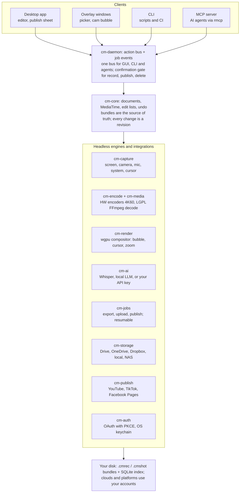

# Technical design

## Architecture

The design from the plan holds: four clients share one action bus over a headless core; v0.1 adds camera, audio, AI, jobs, storage, publishing and auth crates under the same bus.



Only the daemon changes state through engines, so an agent and the GUI always see the same state and the same confirmations. The CLI, the MCP server and the overlay reach it only through `cm-ipc`. The desktop app embeds the daemon in-process and builds its engines (`apps/desktop/src/backend.rs`); it also links engine crates for read-only or pure helpers (preview decoding, caption text, layout, permission probes) and for app-only setup flows that are never exposed to agents (connecting accounts, `destinations.json`). Mutating a capture, a recording or a setting from the desktop goes through an action.

## Recording pipeline

Recording writes each source as its own track on one session clock, using in-process hardware encoders; FFmpeg is used only after recording, for export. This replaces the S3 spike's raw-frame pipe, which carried about 215 MB/s at 1662×1080 30 fps and would need about 2 GB/s at 4K60.

| Track | macOS source | Windows source | Stored as |
| --- | --- | --- | --- |
| Screen | ScreenCaptureKit (`SCStream`) | Windows.Graphics.Capture | HEVC or H.264, fragmented MP4, hardware encoder, frames passed as GPU surfaces (IOSurface / D3D11 texture), no CPU copy |
| Camera | AVFoundation | Media Foundation (DirectShow fallback for virtual cameras) | H.264 1080p fragmented MP4 |
| Mic | `cpal` (CoreAudio) | `cpal` (WASAPI) | 48 kHz 32-bit float WAV (`mic.wav`, raw), denoised copy `mic.denoised.wav` beside it |
| System audio | ScreenCaptureKit audio (its own audio-only stream) | WASAPI loopback | 48 kHz stereo 32-bit float WAV (`system.wav`) |
| Cursor | `CGEventTap` (listen-only, needs Input Monitoring) + `NSCursor` image | Low-level mouse hook + `GetCursorInfo` | `cursor.jsonl` (JSON lines in `MediaTime` ticks) + `cursors/<id>.png` |

**Build status (Oct 21, 2026).** All five tracks are built on macOS, driven by one `RecordingSession` in `cm-daemon`; Windows has stubs only (the encoder returns `not_implemented`; the Windows capture, hook and loopback code is written or stubbed but has never run). Track files are named as in the table and the bundle below.

**Encoders.** macOS uses VideoToolbox through `AVAssetWriter` (or `SCRecordingOutput` on macOS 15+). Windows uses Media Foundation hardware MFTs (NVENC, Quick Sync, AMF behind it); `windows-capture` already wraps this. Both write 2-second fragments, so a crash loses at most one fragment (NFR-6).

**One clock.** Every frame, audio buffer and cursor event is stamped with the OS capture time (mach time on macOS, QPC on Windows) and converted to `MediaTime` (i64, 120,000 ticks per second) against the session origin. Tracks are aligned on export by timestamp, never by sample count.

- **Host timebase.** The `HostClock` is `CLOCK_UPTIME_RAW` on macOS, which is `mach_absolute_time` in nanoseconds (the same base ScreenCaptureKit, AVFoundation, CoreAudio and `CGEvent` stamp with, and it does not tick during sleep). The base is recorded in `session.json` (`clock.timebase`, for example `uptime_raw_ns`, and `clock.origin_ns`). On Windows the clock is QPC converted to nanoseconds; that is not built yet (a monotonic placeholder stands in until the Windows capture backend lands), so Windows timestamps are unverified.
- **Origin before the tracks.** The `SessionClock` origin is taken **before** any recorder starts, and all tracks start concurrently on their own threads. Recorders drop samples stamped before the origin, so creating the clock after the starts would lose the first frames. A slow track (the camera blocks up to 3 s for its first frame) therefore does not delay the others and never makes the origin late.
- **`live_at`.** When the last `start` has returned, the session notes `live_at`: the session time at which every track that started is delivering. It is stored in `session.json` (`session.live_at`) and the manifest (`live_at`) and returned by `start_recording` as `live_at_ms`. Material between 0 and `live_at` is pre-roll (the camera warming up while the screen already runs): the HUD clock, the editor's default in-point and **every export** start at `live_at` (Oct 22, 2026: the interim `quick` path and the edit-list path both begin there, so an untouched recording and an edited one have the same start and length; `live_at` is read from each recording's manifest, measured on the machine that recorded it, never a constant; a recording without it, or with one outside the screen track, begins at the screen's first frame). The countdown runs before `begin`, so pre-roll is never visible content.
- **Start offsets are latency, not drift.** A track's first sample is at its `TrackInfo.start`, not at 0. Seen on macOS (M4 Pro; single short `record_e2e` runs of 30 s or less, output not stored): screen about 300 ms (S6 saw 90 to 330 ms), camera about 500 ms, mic about 80 ms, system audio about 280 ms, cursor about 30 ms. These offsets are real start latency of each source and are constant over a recording; drift is the change of the offset over time (`details.drift_ppm`; one short run showed about -1.7 ppm, which says little about 60 minutes). Exporters place each track at its `TrackInfo.start`.
- **Constant frame rate.** The screen recorder snaps each frame to a fixed slot grid at the target fps (S3 proved the principle): frames that land on an occupied slot are coalesced, and empty slots repeat the previous frame, so the file is exactly the expected frame count and static content costs nothing. Repeats are not counted as late frames. The camera is placed by capture timestamp instead (CAM-2).

**Live webcam bubble.** During recording a borderless, always-on-top window shows the camera preview where the user placed it. That window is excluded from the screen capture (ScreenCaptureKit window exclusion; `SetWindowDisplayAffinity(WDA_EXCLUDEFROMCAPTURE)` on Windows), so the screen track stays clean and the bubble is drawn at export from the camera track. That is what makes the bubble movable and hideable after recording (CAM-3). The control bar is excluded the same way.

**Pause.** Pause stops writing all tracks and records a gap in the session timeline; resume continues in the same files, so no join step is needed. One pause time is passed to every track so all agree on the gap. The screen, camera, mic and system-audio files have **continuous timestamps** (file time = session time minus the pause gaps before it). The cursor log is the one exception and stays in session time. `manifest.gaps` (session time) plus each track's `details.pauses` map file time back to session time; readers must use them (REC-4).

**Crash safety.** Video tracks are fragmented MP4 with a 2 s fragment (the first fragment of a track is shorter by the track's start offset); WAV headers are patched about once per second; telemetry is append-only JSON lines. `recording.lock` in the bundle marks an incomplete bundle and holds what recovery needs (id, title, settings, pause gaps, warnings, `live_at`, and per-track hints such as the start offset and the denoised file name); it is removed only after `manifest.json` is written. Whether a recording is still owned by a live process is decided by an advisory lock on a `recording.maintainer` file in the bundle, which the kernel drops when the process dies, not by a pid. On launch, `Library::recover_incomplete` truncates each track to its last complete fragment or line, repairs WAV headers (`repair_wav`), writes the manifest and removes the lock; expected loss is at most 2 s per track (one `kill -9` run lost up to 1.32 s). A track that cannot be recovered is marked `missing: true` and the others are kept; a bundle with nothing usable is quarantined (the lock is marked `recovery_failed`, later launches skip it, nothing is deleted). Writers `sync_data` at each fragment and header patch, the segment writer's queue is bounded (10 segments; `disk_slow` after 5 s of a full queue), WAV files switch to RF64 past 4 GiB, and a track that stops being writable is kept and truncated (`details.truncated_at`).

**Spike findings the pipeline relies on (S6, macOS).** (1) The recording writer is `AVAssetWriter` with VideoToolbox settings and the CMAF **segment** output (`outputFileTypeProfile` plus `preferredOutputSegmentInterval` = 2 s); the plain `movieFragmentInterval` does not fragment and is not crash safe. (2) B-frames off (`AllowFrameReordering = false`); with them on the segment writer fails after a few seconds. (3) ScreenCaptureKit's minimum frame interval is 1.1× the frame time (exactly 1/60 skipped vsyncs on a 120 Hz display; this is measured on that display only). (4) Retimed sample buffers carry PTS = ticks since the session origin and an explicit one-frame duration (the writer does not rebase in segment mode); retiming wraps the same pixel buffer, so no pixel copy. (5) The bubble and HUD windows are excluded with both `sharingType = none` and `SCContentFilter` exclusion. (6) Use plain `objc2-*` bindings, not a Swift bridge, to avoid the Swift runtime link problem in the product build. Windows equivalents are not built.

**Feasibility status.** Screen capture, sync and mic were proven at 1662×1080 30 fps in S3. Spike S6 is a conditional Go on macOS: 4K60 in-process encoding and window exclusion pass; the camera plus 4K60 run passed narrowly and failed once; the camera/screen 50 ms sync is unproven. The product recorders (M3 slices 1 to 4) ran all five tracks in short runs whose output was not stored; those runs are an indication, not a reproduction of the S6 results (see the NFR notes in the Product spec). Windows is untested for every track.

## Data model

Every capture is a self-contained folder (bundle) of plain files plus a JSON manifest, so it can be moved to an external drive or cloud folder and still opens; SQLite only indexes bundles for search.

**Recording bundle** (`<title>.cmrec/`)

```text
lesson-2026-10-19.cmrec/
├─ recording.lock     # only while recording (or after a crash): marks an incomplete bundle
├─ manifest.json      # schema version, id, title, settings, tracks, gaps, edit list, revisions
├─ session.json       # clock origin and timebase, displays, devices, scale factors, app version, live_at
├─ screen.mp4         # master screen track (fragmented MP4)
├─ camera.mp4         # webcam track (optional)
├─ mic.wav            # raw mic (32-bit float, 48 kHz); mic.denoised.wav beside it
├─ system.wav         # system audio (optional)
├─ cursor.jsonl       # header line, then one event per line, times in MediaTime ticks (session time)
├─ cursors/           # cursor images <id>.png with hotspots, plus index.json
├─ transcript.json    # word-level transcript (Whisper)
├─ thumbs/            # poster frame + timeline strip
└─ exports/           # rendered MP4/GIF files, one per export preset
```

Screenshots use `<title>.cmshot/` with `original.png`, `manifest.json` (annotation ops) and `render.png`.

**Manifest (abridged)**

```json
{
  "schema": 1,
  "id": "rec_01JA8K2M7Q",
  "title": "Kubernetes probes in 5 minutes",
  "created": "2026-10-19T09:12:03Z",
  "tick_rate": 120000,
  "tracks": {
    "screen": { "file": "screen.mp4", "size": [3840, 2160], "fps": 60, "codec": "hevc" },
    "camera": { "file": "camera.mp4", "size": [1920, 1080], "mirror": true },
    "mic":    { "file": "mic.denoised.wav", "rate": 48000, "channels": 1 }
  },
  "edits": [
    { "in": 240000, "out": 7200000, "speed": 1.0,
      "layout": { "camera": { "visible": true, "shape": "circle", "rect": [0.78, 0.72, 0.18, 0.18] } },
      "zooms": [ { "at": 1800000, "len": 360000, "focus": [0.62, 0.31], "scale": 1.8 } ] }
  ],
  "captions": { "enabled": true, "burn_in": false },
  "revisions": [ { "rev": 3, "action": "trim", "by": "agent:claude", "at": "2026-10-19T09:20:41Z" } ]
}
```

**Recording manifest additions (built).** A `.cmrec` manifest written at stop or recovery also carries:

- `settings`: the request as it was used (target, size, fps, codec, quality, camera and bubble facts, mic, system audio, cursor, max duration, exclusions, `requested_by`).
- `gaps`: the closed pause gaps in session time, `[{ from, to }]` in ticks.
- `captions`: `{ "enabled": false, "burn_in": false, "lines"?: [...] }`: `enabled` shows the captions in the editor's preview, `burn_in` makes exports burn them in by default, `lines` are the user's edited caption lines (AI-1). Both switches are changed by `set_caption_options`, one undoable revision each.
- `warnings`: notes raised while recording (a track failed to start, a device was lost, `disk_low`), each `{ code, message, track, ... }`.
- `stop_reason` and `started_by`: why and by whom (`user` or `agent:<client>`) the recording ended and started.
- `live_at` (ticks) and `session` (`{ live_at, ... }`): see One clock.
- `recovered`: `{ at, lost_ms_max }`, present only on a recovered bundle (its first revision is `recover`).
- Each `tracks` entry is the recorder's `TrackInfo`: `file`, `start` and `end` (session time), `stats` (`delivered`, `written`, `dropped`, `late`) and a `details` object with source facts (size, fps, codec, `pauses`, `mirror`, `raw_file`, `drift_ppm`, `gaps`, ...). A track file name is `TrackInfo.file`, so the mic entry names `mic.denoised.wav` when denoising was on. `details.codec` is `hevc`, `h264` or `vp9` (`cm_core::VideoCodec`; `vp9` is the Linux software fallback, VP9 in a fragmented MP4, D-R2). A track may also carry `encoder` (the FFmpeg or OS encoder name), `software` (a CPU encoder) and `cursor_source` (`pixels`, `track` or `none`) from `cm_core::describe_video_track`; older manifests lack these keys and readers must treat them as optional. No schema bump: `details` is free-form and an unknown codec name reads as "unknown", never as an error. The abridged manifest above is a sketch of the shape; the field set is defined by the code (`cm-library` `RecManifest`, `cm-core` `TrackInfo`).

`session.json` adds `clock { origin_ns, timebase, tick_rate }`, the displays with scale factors, devices, `app_version`, `live_at`, and track facts such as `cursor.clicks` (`"unavailable"` when Input Monitoring is missing, REC-7.AC4).

- **Time.** All times are `MediaTime` ticks (120,000 per second, exact for 24, 25, 30, 50 and 60 fps).
- **Layout coordinates** are fractions of the output frame, so one edit list serves 16:9, 9:16 and 1:1 exports.
- **Edits never touch the tracks.** Trim, cut, speed, layout and zoom are entries in `edits`; the master files are read-only after recording.
- **Revisions** record who made each change (`user` or `agent:<name>`), which backs undo and the agent audit trail.

**Library index (SQLite)**: `captures` (id, path, title, kind, duration, created), `transcripts_fts` (FTS5 over transcript text), `destinations`, `jobs`, `uploads` (destination, remote id, link, status), `publications` (platform, remote id, url, status).

## Export and render

Export is one GPU compositor run per preset: decode the tracks, draw each output frame from the edit list, encode with the hardware encoder. The same renderer drives the editor preview, so what you see is what you export, and it runs headless for agents and the CLI.

**Per-frame layer order**

1. Background and padding frame (solid, gradient or image), when enabled
2. Screen track, cropped and zoomed per the edit list (smooth ease-in/out between zoom states)
3. Redrawn cursor (size, smoothing, click rings) when the editable cursor is on; otherwise the cursor baked into the screen track
4. Camera bubble: camera frame masked to a circle or rounded rectangle, border and shadow, at the layout rect
5. Burned-in captions, when chosen
6. Annotations (text, arrows) placed on the timeline (P2)

**Building blocks**

| Stage | v0.1 choice | Why |
| --- | --- | --- |
| Decode | FFmpeg LGPL libraries with hardware decode (VideoToolbox, D3D11VA) | One path for every codec the bundle can hold |
| Composite | `wgpu` shaders; `tiny-skia` + `cosmic-text` for captions and annotation layers uploaded as textures | GPU speed at 4K60; one renderer for preview and export |
| Encode | Same native hardware encoders as recording; no software H.264 encoder ships in v0.1 (the bundled LGPL FFmpeg has none; Macs without a hardware H.264 encoder, before about 2016, are not supported) | No GPL encoder and no H.264 patent exposure from a source-built software encoder |
| Audio mix | Mic (denoised) + system audio, offset-aligned, loudness-normalized to −14 LUFS for platform presets | Close to the loudness YouTube plays back at; configurable per preset |
| Mux | MP4 with fast start, AAC-LC 48 kHz | YouTube and TikTok requirements |

**Fast paths.** When the edit list is only trims on a single track with no layout changes, the export re-muxes without re-encoding ("Source" preset), which takes seconds even for long lessons. Cuts land on the nearest keyframe in fast mode, or re-encode only the frames around each cut in precise mode.

**Throughput target.** 4K30 export at real time or faster on Apple Silicon and NVENC machines; 1080p at 3× real time or faster.

## Jobs, secrets and OAuth

Everything slow (export, transcription, AI metadata, upload, publish) runs as a persisted background job, so the app, an agent, or a restart never loses work in progress.

**Job queue**

- Jobs live in SQLite with type, inputs, state (`queued`, `running`, `paused`, `failed`, `done`, `cancelled`; the last from EXP-4), progress, attempts, and dependencies. A publish job waits on its export job; an upload waits on its export when "upload export" is chosen.
- Resumable state (Drive/YouTube session URI, OneDrive upload URL, Dropbox session id, TikTok upload URL and chunk index) is saved after every chunk, so uploads resume after network loss or restart (NFR-8).
- Retries use exponential backoff with jitter for network errors and 5xx; 4xx errors stop the job with a readable reason.
- Concurrency: one export at a time (GPU-bound), two uploads, one transcription. Recording pauses exports automatically.
- Every job emits progress events on the action bus, so the GUI, CLI (`capturemann jobs watch`) and MCP clients see the same status.

**Secrets**

- OAuth tokens, user-supplied client IDs/secrets and AI API keys are stored with the `keyring` crate (macOS Keychain, Windows Credential Manager); config files hold only a key name. All of an app's secrets live in ONE keychain item (`dev.capturemann.app` / `vault`, a JSON blob; `cm_auth::VaultStore`), because the keychain asks for the user's password once per item: one item means one "Always Allow" and one prompt per sign-in instead of one per secret (decided Oct 23, 2026). Items written by the earlier one-item-per-secret layout are moved into the vault the first time their key is read.
- Tokens are refreshed on demand; a revoked token marks the connection "needs reconnect" instead of failing silently.

**OAuth for a desktop app**

- Authorization code flow with PKCE and a loopback redirect (`http://127.0.0.1:<random port>/callback`) in the system browser, as recommended for native apps (RFC 8252). No embedded web views.
- Bring-your-own mode: the user pastes their app's client ID (and secret where the platform requires one) once per platform; a guided setup screen explains each platform's console steps.
- Scopes are the smallest that work: Drive `drive.file`, OneDrive `Files.ReadWrite`, Dropbox `files.content.write` (+ `sharing.write`, and `account_info.read`, `files.metadata.read`, `sharing.read` for the account email, the metadata check and existing links), YouTube `youtube.upload` (+ `youtube` for playlists and thumbnails), TikTok `video.upload` / `video.publish`, Facebook `pages_show_list`, `pages_read_engagement`, `pages_manage_posts`.

## Crates and stack

The workspace grows from 9 to 17 crates; every crate under `crates/` is headless and testable without a display, and the two apps are thin shells. Built so far (Oct 21, 2026): `cm-core`, `cm-capture`, `cm-camera`, `cm-audio`, `cm-cursor`, `cm-encode`, `cm-render` (annotations and the headless `wgpu` frame compositor; not yet driven by the edit list), `cm-jobs`, `cm-library`, `cm-daemon`, `cm-mcp`, `cm-cli`, and `cm-ipc` (the small client side of the daemon IPC, linked by the CLI, MCP server and overlay; not in the table below), plus `apps/desktop` and `apps/overlay`. `cm-media` exists as the interim FFmpeg-sidecar exporter (the `quick` preset: screen + camera bubble + audio in one MP4; decode, re-mux and the other presets are M4). `cm-ai` has the AI-1 engine (the Whisper model store, the whisper.cpp transcriber and captions; suggestions and the actions come next). `cm-auth` has its first slice (Oct 23, 2026): the `SecretStore` trait with the keychain and in-memory stores, PKCE, the loopback listener, the code exchange and the `TokenManager` refresh, tested with fakes; the keychain and the real providers are not exercised yet. `cm-storage` has the trait and the local folder provider. `cm-publish` has its first slice (Oct 23, 2026): the `PublishProvider` trait, platform rules and metadata validation, and the YouTube provider with an in-process fake YouTube server in its tests; it reuses `StorageHttp`, `TokenSource`, `Progress` and `ResumeState` from `cm-storage`; no job, action, MCP tool, CLI or UI yet; TikTok and Facebook Pages are not started.

| Crate | Responsibility | Key dependencies |
| --- | --- | --- |
| `cm-core` | Primitives (`MediaTime`, geometry), documents, actions, commands, undo, revisions | `serde` |
| `cm-capture` | Screen capture backends, window exclusion, session clock | `screencapturekit`, `windows-capture`, `xcap` |
| `cm-camera` | Camera enumeration, preview frames, camera track | AVFoundation / Media Foundation bindings, or Cap's MIT `cap-camera*` crates |
| `cm-audio` | Mic and system audio, level meters, denoise | `cpal`, `nnnoiseless` |
| `cm-cursor` | Cursor telemetry capture and cursor image cache | platform hooks |
| `cm-encode` | Hardware recording encoders, fragmented MP4 writer, export encoders | VideoToolbox / Media Foundation (no software encoder) |
| `cm-media` | Decode, mux, re-mux, audio mix via pinned LGPL FFmpeg | `ffmpeg-next` (LGPL dynamic) or the FFmpeg sidecar |
| `cm-render` | GPU compositor (preview + export), annotations, captions | `wgpu`, `tiny-skia`, `cosmic-text` |
| `cm-ai` | Transcription, metadata generation, zoom and silence suggestions; provider trait for text models (the built-in engine in 0.2.0) | `whisper-rs` (whisper.cpp built from source, needs `cmake`; Unlicense binding over MIT code), `ureq` with the system TLS stack for model downloads, OpenAI-compatible HTTP client for the built-in engine's loopback helper |
| `cm-auth` | OAuth (PKCE + loopback), token refresh, keychain storage. In progress: built and tested with fakes; no daemon wiring, no provider run | `keyring`, `ureq` (system TLS), `open`; the flow is hand-written (no `oauth2` crate) |
| `cm-storage` | `StorageProvider` trait + local, Google Drive, OneDrive, Dropbox | `reqwest` |
| `cm-publish` | `PublishProvider` trait + YouTube (built, first slice), TikTok, Facebook Pages | `cm-storage`'s HTTP seam (`ureq`, system TLS) |
| `cm-jobs` | Persistent job queue, retries, progress events | `rusqlite`, `tokio` |
| `cm-library` | Bundles, SQLite index, FTS search, thumbnails | `rusqlite` |
| `cm-daemon` | Action bus, sessions, JSON-RPC server, event stream | `tokio`, `interprocess` |
| `cm-mcp` / `cm-cli` | MCP server (stdio + local HTTP), CLI | `rmcp`, `clap` |
| `apps/desktop` | Studio, library, settings, launcher, permissions, editor, HUD, bubble, tray, hotkeys; publish sheet is M6 | GPUI (spike S5, pinned `gpui-pre`) |
| `apps/overlay` | Region picker, webcam bubble window, recording control bar | `winit` + `softbuffer`/`wgpu`, `objc2` |

**Provider traits** keep integrations swappable and let the community add destinations without touching the core:

```rust
#[async_trait]
pub trait StorageProvider {
    fn id(&self) -> &'static str;                       // "gdrive", "onedrive", "dropbox", "local"
    async fn upload(&self, file: &Path, target: &Target, resume: Option<ResumeState>,
                    progress: Progress) -> Result<Uploaded>;   // returns remote id + share link
}

#[async_trait]
pub trait PublishProvider {
    fn id(&self) -> &'static str;                       // "youtube", "tiktok", "facebook"
    fn requirements(&self) -> PlatformRules;            // size, duration, fps, fields
    async fn publish(&self, video: &Path, meta: &PublishMeta, resume: Option<ResumeState>,
                     progress: Progress) -> Result<Published>; // remote id + URL + status
}
```

## Settings keys

`settings.json` in the config directory (`~/Library/Application Support/CaptureMann/`, or `CAPTUREMANN_CONFIG_DIR`) holds one flat object of dotted keys, read by the daemon through `SettingsStore` and shared by the app and a CLI-started daemon. Absent keys mean "default"; defaults are not written. **Maintainer** says who may write the key: **app-only** keys are refused for socket clients (agents) with `user_declined` and `data.reason: "app_only_setting"` and can only be written in process by the app's own UI; **agent-writable** keys can be set with `set_settings` (key at most 128 bytes, value at most 16 KiB and 8 levels deep, at most 64 keys per call; any key containing `token`, `secret`, `password`, `passwd`, `api_key`, `apikey`, `credential`, `private_key` or `bearer` is refused). A corrupt file is moved to `settings.broken-<unix seconds>-<n>.json` (the newest five are kept) and defaults are restored. This table is the registry: add a key here when code starts using it.

| Key | Maintainer | Type and default | Defined in |
| --- | --- | --- | --- |
| `appearance.theme` | agent-writable | `"system"` (default), `"dark"` or `"light"` | DESIGN §1 (Studio only) |
| `capture.copy_to_clipboard` | agent-writable | boolean, `true` | CAP-4 |
| `capture.save_folder_enabled` | **app-only** (`capture.save_folder*`: it makes the app write files outside the library) | boolean, `false`: also save a PNG of each capture and of each annotation save to the folder below | CAP-4.AC2 |
| `capture.save_folder` | app-only | folder path string; absent means none chosen (the setting then cannot take effect and the toast says so). Never created by the app: a missing folder is an unplugged drive | CAP-4.AC2, AC4 |
| `capture.save_pattern` | app-only (no UI; edit `settings.json`) | file name pattern, default `CaptureMann {yyyy-MM-dd} at {HH.mm.ss}.png`; `{...}` holds `yyyy MM dd HH mm ss`; path separators and `..` never survive; ` (2)`, ` (3)` on a name clash | CAP-4.AC2, AC3 |
| `capture.delay_s` | agent-writable | `0` (default), `3`, `5` or `10`: the remembered capture delay shared by the tray "Capture delay" submenu and the library toolbar; other values are refused | CAP-5 |
| `library.path` | app-only | folder path string; absent means `CAPTUREMANN_LIBRARY`, then `~/Movies/CaptureMann` | LIB-2 |
| `permissions.onboarded` | app-only | boolean, set once the setup screen was seen | PRM-1.AC11 |
| `privacy.excluded_apps` | app-only | array of bundle ids or executable names, added to the built-in list; a request can add, never remove | REC-6 |
| `shortcuts.capture_region`, `.capture_window`, `.capture_display`, `.toggle_recording`, `.pause_recording`, `.open_library`, `.open_launcher`, `.discard_recording`, `.restart_recording`, `.annotate_last`, `.toggle_audio_recording`, `.add_marker` | app-only | chord string such as `alt+shift+1` (at least one modifier and one key); defaults in CAP-2 | CAP-2 |
| `agents.client_policies` | app-only (hidden from `get_settings`) | object `{ "<client name>": "allowed" \| "read_only" \| "blocked" }`; mirrored in `client_policies.json` | AGT-2 |
| `agents.deny_unknown_clients` | app-only | boolean, absent means `false`; set when the policy list could not be restored, so clients with no entry are blocked (`default_deny`) until the user chooses "Allow unknown clients" | AGT-2 |
| `storage.pause_uploads_while_recording` | app-only | boolean, `true` | EXP-4, STO-3 |
| `storage.copy_link_when_done` | app-only (part of the `storage.*` family) | boolean, `true`: when an upload finishes with a share link the app copies it to the clipboard | STO-4 |
| `export.auto_on_stop` | app-only | boolean, `true`; skipped with a hint when no FFmpeg is found | EXP-1 |
| `recording.size` | agent-writable | `"source"` (default), `"2160p"`, `"1440p"`, `"1080p"`, `"720p"` | REC-2 |
| `recording.fps` | agent-writable | `30` (default) or `60`; 60 as a default falls back to 30 until the self-test passes | REC-3 |
| `recording.codec` | agent-writable | `"auto"` (default), `"hevc"`, `"h264"` | REC-2 |
| `recording.quality` | agent-writable | `"high"` (default), `"balanced"`, `"small"` | REC-2 |
| `recording.cursor` | agent-writable | boolean, `true` | REC-7 |
| `recording.countdown_s`, `recording.resume_countdown_s` | agent-writable | integers 0 to 10; defaults 3 and 1 | REC-1, REC-4 |
| `recording.fps60_selftest` | app-only (written by the self-test only) | `{ version, results: { "<display>:<w>x<h>:<codec>": {...} } }` | REC-3 |
| `recording.last_target`, `recording.camera`, `recording.mic`, `recording.system_audio` | agent-writable | the start sheet's remembered choices: `"display"`, `"window"` or `"region"`, and booleans | REC-1 |
| `recording.hud_positions` | app-only | object `{ "<display>": [x, y] }` of HUD center fractions | REC-5.AC4 |
| `camera.device`, `audio.mic_device` | agent-writable | the default camera and microphone chosen in Settings > Webcam & audio (a device id; absent means the system default); used when a start names no device; a missing device falls back to the system default for that recording and the id is kept | CAM-4, AUD-1 |
| `camera.shape`, `camera.size`, `camera.mirror`, `camera.position` | agent-writable | `"circle"` or `"rounded"`; `"s"`, `"m"` (default) or `"l"`; boolean, `true`; a position name (default `"bottom-left"`) or `[x, y]` fractions; the stored position is only restored when `camera.remember_position` is on | CAM-1 |
| `camera.remember_position` | agent-writable (like the other `camera.*` keys; the desktop toggle writes it) | boolean, `false`: every recording starts bottom-left; `true`: restore the last dragged `camera.position` | CAM-1.AC8 |
| `audio.noise_suppression` | agent-writable | boolean, `true` | AUD-3 |
| `editor.tool_styles` | agent-writable | object of the last color and width per annotation tool | ANN-1 |
| `ai.auto_transcribe` | **app-only** (`ai.*`) | boolean; the user's choice, else on only when the machine has 16 GB of RAM or more. Transcribes after a recording stops, but only with an installed speech model; never downloads one | AI-1 |
| `ai.glossary` | **app-only** (`ai.*`; agents can read it, not write it) | array of `{ term, heard_as?: [string] }` (at most 100 entries and 15,000 bytes): names and terms spelled the user's way. Its terms prime Whisper's `initial_prompt` and each `heard_as` spelling is replaced by the term in every new transcript | AI-6a |

Reserved but not used by code yet: `mcp.*` and `auth.*` (app-only, for the HTTP token and account configuration), `storage.*` and `export.*` beyond the keys above, `library.*`. "Launch at login" is **not** a setting: it is a `launch_at_login` file beside `settings.json` (CAP-2), so an agent cannot enable persistence. Environment overrides: `CAPTUREMANN_SOCKET`, `CAPTUREMANN_LIBRARY`, `CAPTUREMANN_CONFIG_DIR`, `CM_FFMPEG`.
