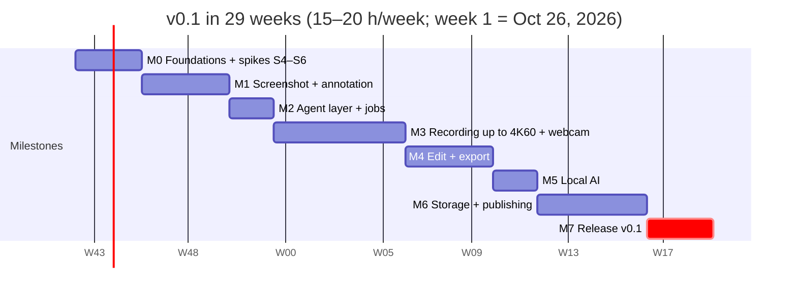

# Delivery plan

## Revised timeline

Adding webcam, max-resolution recording, cloud drives and publishing to v0.1 moves the release from week 17 to week 29; the spikes already done (S1–S3) are not counted.

| Milestone | Weeks | Scope | Gate |
| --- | --- | --- | --- |
| M0 | 1–3 | cm-core, CI; S4 cursor, S5 UI framework, S6 4K60 encode + webcam + bubble exclusion | S6 records 4K60 screen + 1080p camera with ≤ 1% late frames |
| M1 | 4–7 | Overlay, hotkeys, tray, editor canvas, annotation tools, clipboard, library | Good enough for your own daily screenshots |
| M2 | 8–9 | Daemon, action bus, MCP, CLI, JSON-RPC, job queue, confirmation dialogs; UI follow-up: LNC-1 launcher shell (P1) and Settings → Agents & CLI content | An MCP client captures, annotates and exports end to end |
| M3 | 10–15 | Native encoders, webcam track + live bubble, mic, system audio, cursor, crash-safe | 30-min 4K30 with webcam passes the frame and sync budgets |
| M4 | 16–19 | Trim, cut, speed, bubble layout, editable cursor, auto-zoom, compositor, presets | Export matches the editor preview frame for frame |
| M5 | 20–21 | Whisper transcripts and captions, metadata generation, cut and zoom suggestions | All AI works offline on 16 GB; P0/P1 scope cut decided |
| M6 | 22–26 | OAuth + keychain, Google Drive, YouTube (scope cut Oct 23, 2026: OneDrive and Dropbox are built but "Coming soon"; TikTok and Facebook Pages are deferred to a later release or community pull requests) | Upload to Google Drive and publish to YouTube end to end with BYO credentials |
| M7 | 27–29 | Signing, notarization, installers, auto-update, docs, setup guides, demo video | Every v0.1 acceptance criterion is checked |
| 0.2.0 voice and meetings | released after 0.1.0 (no date; the maintainer cuts it) | Audio recording (VOC-1), audio editor and export (VOC-2), markers, translation (AI-5), the built-in text engine (AI-7), speaker labels (AI-8), reports (AI-9), Large v3 Turbo; VOC-3 live transcript, the first-use setup sheet (0.2.1) and Ollama/LM Studio are later | Built and tested with fakes, with real engines run through the CLI on one meeting (Oct 27, 2026); the hardware checks of the list below are the gate for calling it verified |
| Platforms after v0.1 | after v0.1 | Intel Macs, then Windows, then Linux (maintainer order, Oct 25, 2026) | Each platform's boxes are checked on that platform |
| Later | after 0.2.0 | Official audited apps (TikTok first), Reels, share page, scrolling capture | Order set by beta feedback |

**Release 0.2.0, voice and meetings (Oct 27, 2026).** Built: VOC-1, VOC-2, AI-5 (Whisper to English, the text model to other languages), AI-7 (bundled `llama-server`; Gemma 4 E2B recommended, Gemma 4 26B-A4B for 32 GB Macs, Qwen3.5 4B and 2B), AI-8 (speaker models inside the app, automatic run on by default), AI-9 (six templates, citations, task ticks, report view). Evidence: tested with fakes plus real engines through the CLI on one 11-minute English meeting (transcript with Turbo 24 s, speakers by 60 s, report 24 s, Vietnamese translation 84 s with 0 lines untranslated; a 45-minute transcript through the report in 3 chunks in 164 s, 0 items dropped); full workspace tests pass also with the bundled FFmpeg (140 groups), clippy and fmt clean, `cargo deny` licences, bans and sources pass; release dry run (`make bundle-release` into a scratch folder and `verify-release.sh --allow-unsigned`) passed, app 181 MB; `exp4_cancelling_an_edited_export_cleans_up` hung once in a busy full run (6 of 6 alone): the cancel path is sound, the compositor stalled; the test is now bounded, the export has no stall timeout yet. Hardware, as reported by the maintainer on Oct 27, 2026 and not stored: the latest dev bundle's recording, screenshot and audio work; the speaker split on one meeting is accepted as working; the Vietnamese strings reviewed: passed; the text model pins confirmed by downloads. **Open verification (0.2.0):** VOC-1 hardware checks (3-hour soak, kill -9 recovery, lid and sleep, consent, markers) and VOC-2 export checks (WAV, M4A, loudness) with reports in `verification/`; the upgrade test on a copy of a real pre-0.2 library (only a synthetic 0.1.0 library was migrated: index 2 to 3, files unchanged); speaker accuracy at scale (users and team, coming weeks); the ONNX Runtime ThirdPartyNotices text for `THIRD_PARTY_LICENSES.md`; `cargo deny check advisories` (needs network); the review set of AI-9 and Vietnamese quality (S8). Owners and the checklist: `docs/project/status.md`, "Release checklist for 0.2.0".

**Status (Oct 21, 2026, after the five-reviewer feature review and the fix wave).** macOS only; Windows is not built in CI (v0.1 is macOS only) and nothing has run on a Windows machine, so it is unverified for every milestone. "Tested with fakes" means automated tests with scripted sources; "verified on hardware (as reported)" means a run on the MacBook Pro (Apple M4 Pro, macOS 26) whose output was not stored. Hardware figures are listed in the NFR status table of the Product spec.

| Milestone | Status | Notes |
| --- | --- | --- |
| M0 | Done on macOS (S6 conditional Go) | S1, S2 pass; S3 passes at 60 s (10-minute soak pending); S4 partial (cursor images and CPU pass; timestamp accuracy and click completeness unmeasured); S5 decided: GPUI, conditional on a 1080p60 preview path; S6 conditional Go (screen 4K60 passes at 0.26% to 0.33% late; with the camera it passes narrowly and failed once; camera/screen 50 ms sync unproven). Spike reports are in the git-ignored `spike-out/` (not in the repo). Windows pending for all |
| M1 | Built on macOS; unverified by hand | Overlay picker, hotkeys, tray, annotation editor, clipboard (PNG and, on macOS, TIFF), "Also save a PNG to a folder" and the remembered capture delay on the library toolbar and tray (tested with fakes, not seen by eye), the live library file watcher (daemon polling watcher, tested with fakes), library and design kit phase 1 are built and unit tested. Auto-redact (ANN-2.AC4) is built on macOS since Oct 23, 2026 (`suggest_redactions`, the editor button; tested with a scripted recognizer, the editor UI untested by eye, Windows later) |
| M2 | Built on macOS; tested with fakes and scripted clients | Daemon, action bus, JSON-RPC, 55 MCP tools (`cm-mcp`, including the eleven edit tools), CLI, job queue, the confirmation gate, per-client policy and resource limits. Built since the review: `rename_capture`, a local `delete_capture` (Trash), the internal `rescan_library`, and a fail-closed default for unknown clients. Not built: `publish_video` for TikTok and Facebook (`not_implemented`; so does `delete_capture` with `also_delete_remote: true`; the YouTube engine is built, see M6), transcribe and upload job handlers (the `export` handler is built for the interim `quick` preset), MCP resources and prompts, `capturemann mcp` (the server is the `cm-mcp` binary) |
| M3 | Built on macOS; the hardware gate is not run | Engine, all five tracks, pause, crash recovery with an maintainer lock and quarantine, the 60 fps self-test (daemon side, tested with fakes), the start sheet, HUD, countdown, area brackets and live bubble (unit tested). Open: the M3 gate (30-minute 4K30 with webcam), the camera/screen 50 ms measurement (NFR-3), the self-test on hardware, a real hardware-encoder rejection (the start fails with `hardware_encoder_unavailable`; the software H.264 fallback was removed Oct 24, 2026, tested with fakes only), the Windows backends |
| M4 to M7 | M4 in progress (edit model and the eleven edit actions built and tested with fakes, Oct 22, 2026; the timeline math is `cm_core::edit`; the audio mix and stretch are `cm_audio::mix`, called by the edited export); M5 in progress (the AI-1 engine in `cm-ai` is built and tested with fakes, Oct 22, 2026: model store with user-started downloads, whisper.cpp transcriber, captions; no real model run; the 12 AI actions are built through the daemon, MCP and CLI and wired to the real engine (`cm_daemon::ai_engine`), tested end to end with a scripted transcriber); M6 and M7 not started | `cm-render` has annotations and, since Oct 22, 2026, the headless `wgpu` frame compositor (background, padding, rounded screen, camera bubble, camera full, side by side, NV12/BGRA/RGBA inputs; golden-frame tests; about 3 to 9 ms per frame at 1080p to 4K on an Apple M4 Pro including upload and readback), connected since Oct 22, 2026 to the edit list, FFmpeg decode and the hardware encoder by the edited export in `cm-media` (trim, cuts, speed, background, padding, radius, shadow, camera bubble; 4K to 1080p area-filtered; tested with FFmpeg and a GPU on this Mac, 6.5x real time at 1080p, not observed on CI or Windows), with the EXP-2 platform presets (`youtube-4k`/`1440p`/`1080p`, `vertical-1080`, `square-1080`, `source`) and EXP-3 GIF and WebM (including "fit under N MB") built on top of it (Oct 22, 2026; the preset table is `crates/cm-media/data/presets.toml`). **Interim exporter (built):** every recording gets one combined MP4 rendered by the FFmpeg sidecar (`cm-media`, preset `quick`, `export_video` / `capturemann export`, job type `export`, setting `export.auto_on_stop`, skipped with a hint when no FFmpeg is found). Packaging: the macOS bundle is assembled atomically with entitlements, `NOTICE` and `THIRD_PARTY_LICENSES.md` (`make bundle`, `make licenses`), `cargo deny check` passes locally and in the CI job's configuration, CI installs FFmpeg and uses `--locked`. The LGPL FFmpeg is built and bundled (Oct 22, 2026; NFR-12); notarization is a release blocker (not done). See `features/08-export.md` |

## Verification debt

What has **not** been verified on real hardware or at the required scale, as of Oct 21, 2026. Items here are the honest reason several features read "In progress" instead of "Done". Nothing in this list should be claimed as met in release notes.

- **M4 hands-on checks (the M4 gate was accepted by the maintainer on Oct 22, 2026 with these still owed).** Terminal measurements passed (`verification/M4-GATE-2026-10-22.md`); nobody has yet watched the editor window or the preview, listened for pitch and A/V sync (PLAY-1, EDT-2), looked at the Camera, Cursor, Zoom and Reframe cards, compared export colours in QuickTime, Safari and Chrome (EXP-2), or run the real-recording `ffprobe` colour-tag check. The EDT, CAM-3 and EXP statuses stay "In progress" until those reports are stored. Open maintainer questions: follow-cursor zoom edge case (EDT-4.AC3, left for user feedback) and the "Lens Violet" preset name.
- **Windows, everything.** No Windows machine has run any code (capture, encoder, camera, audio loopback, cursor hook, the app, the installer). Windows code paths compile in CI only where they are built at all; the recording backends are stubs that return `not_implemented`.
- **NFR-3, the 50 ms sync.** The product pipeline was never measured: it needs the flash window against the camera and the beep against the mic (`tests/manual/CAM-2.md`, `AUD-1.md`), at start and after 30 minutes.
- **Soaks.** The 30-minute and 2-hour recordings (NFR-2, REC-2.AC5), the 10-minute 2160p60 gate, and the S3 10-minute soak.
- **5K, worst-case content and other displays.** A 5120×2880 display (REC-2.AC2), a 60 Hz and a true 4K display, full-screen video or game content, mixed-DPI multi-monitor capture and window moving (REC-1.AC2).
- **Exclusion on real apps.** A password manager launched after the recording started (REC-6.AC1, AC2: the 1 s watcher is tested with fakes only), the built-in bundle ids (written from memory), and the own-window exclusion of screenshots on macOS 14+ by eye.
- **REC-7.AC1 and AC2.** Cursor timestamp accuracy against the baked cursor and click completeness need the injection test (`CM_ALLOW_INPUT_INJECTION=1`, Accessibility and Input Monitoring).
- **Mid-recording permission revocation.** Built Oct 23, 2026 (PRM-1.AC13: Screen Recording stops the run cleanly with `reason: "permission_revoked"`, Camera and Microphone only warn) and tested with fakes; what macOS really does when the grant is removed during a recording (a ScreenCaptureKit -3801 stop, or the process being ended) was never observed: `tests/manual/PRM-1.md` (section "Revoked during a recording"). Camera hot-plug events: `tests/manual/CAM-1.md`.
- **The 60 fps self-test on hardware** (`cargo test -p cm-daemon --test real_selftest -- --ignored`), including its CPU half, which is not measured at all, and the 60 fps recording with the camera on.
- **External and special devices.** USB webcams, Continuity Camera and virtual cameras (CAM-1, CAM-4), Bluetooth and USB microphones and a mid-recording device change (AUD-1), system audio from other apps and output-device changes.
- **Real UI by eye.** The HUD, countdown, brackets, bubble, toasts, start sheet, confirmation dialog, setup screen and launcher have unit tests but no stored hands-on report (REC-5.AC1 timing, AC4 snapping, AC9, AC10, LNC-1.AC1, AC6, AC9, the real OS permission dialogs and Settings panes, the restart flow).
- **The `#[ignore]` hardware tests.** 33 tests are ignored and run only by hand (`grep -rn "#\[ignore" crates apps | wc -l`): `cm-capture` 15 (`record_real` 10, `real_display` 5), `cm-audio` 7 (`hardware` 6, `perf` 1), `cm-cursor` 4 (`macos/hardware_tests`), `cm-camera` 2 (`mac_camera`), `cm-encode` 2 (`mac_encode`), `cm-daemon` 1 (`real_selftest`), `cm-media` 1 (`quick_export` timing probe), `cm-render` 1 (a 5K blur timing test, release build only). No run of them is stored in the repo.
- **MCP and agents.** A conformance run with the official MCP inspector and a real Claude Desktop or Claude Code session (AGT-1.AC1); the HTTP transport with real clients.
- **Export.** FFmpeg-gated tests run in CI only once the workflow has run on GitHub (the workflow was changed but not observed); the exporter and the whole workspace suite were run with the bundled LGPL FFmpeg on the developer's Mac on Oct 23, 2026 (every preset, burned-in captions, the Whisper audio decode and the preview decoder; the scratch app bundle verifies, also hardened), but never on a Mac that has never had Homebrew, and notarization was never submitted.

**Design kit follow-ups.** The design kit in `design/` adds UI scope that the 29-week plan did not list. See `plans/design-implementation.md` for the full table and `../PLAN.md` ("Design kit adoption") for the order. Placement:

| Item | Spec | Milestone | Why |
| --- | --- | --- | --- |
| Tokens, Geist fonts, app and tray icons, window shell restyle | DESIGN §3, §8, CAP-2.AC6–AC7 | M1 tail | Restyle of surfaces that already exist; no new behavior; cheapest before more UI is built on the old look |
| LNC-1 launcher (shell, search, groups, disabled rows, screenshot, library and MCP-config commands) | LNC-1 | M2 follow-up | Needs only actions that exist after M1/M2 (`capture_screenshot`, library, MCP config); the record command enables itself in M3, publish and cloud save in M6 |
| PRM-1 permissions (Settings → Permissions, first-run window, library banner, Record sheet failure state) | PRM-1, DESIGN §5.10 | M2/M3 follow-up | Needed before anyone but the author can use captures and recording: a missing Screen Recording grant looked like "No display found" |
| Settings → Agents & CLI content (status, config snippet, capability list) | AGT-1, AGT-2, DESIGN §5.8 | M2 | Same milestone as the agent layer it controls |
| Settings → Destinations content | STO-2, PUB-1, DESIGN §5.8 | UI shell in M2 (rows disabled); live in M6 | Needs `cm-auth` and `cm-storage` |
| Recording HUD (with Restart), brackets and `rec` outline, bubble ring | REC-5, CAM-1, DESIGN §5.2, §5.4 | M3 | Needs the recording engine; UI-only build possible earlier behind a debug flag |
| Timeline editor, inspector, editor restyle | EDT-1…5, DESIGN §5.5 | M4 | Built for EDT-1 to EDT-3 on Oct 22, 2026 (route `RecordingEditor`, untested by eye); needs the compositor, which now exists; EDT-4 and EDT-5 controls, the Webcam, Output and Publish-to cards and the header's Save to drive and Publish are not built |

LNC-1 is P1, so it falls under the week-20 scope cut. The product maintainer decided on Oct 21, 2026 (OD-11) to schedule it as an M2 follow-up, absorbing it and the Agents & CLI UI into the two-week M2 at roughly one extra working week of UI work at 15–20 h/week; M2 may overrun by that much. The launcher has been delivered. It remains the first item to move to a patch release if the plan slips. Draw on screen (REC-9) is P2 and not in the plan; the HUD shows its button disabled. The bubble keeps its three size presets (OD-1), so no slider work is planned.

Recording (M3) and publishing (M6) are the two largest blocks. Week 20 is the hard scope cut: any P1 item not on track moves to a v0.1.x patch so the release date holds.
- **Release 0.2.0 (voice and meetings), Oct 27, 2026.** Owed by the maintainer, with a `verification/` report each: VOC-1.AC2, AC5, AC6 and the lid, sleep, consent and marker steps (`tests/manual/VOC-1.md`); the WAV and M4A exports and loudness (`tests/manual/VOC-2.md`, VOC-2.AC5 timing); `tests/manual/AI-5.md`, `AI-7.md`, `AI-8.md` (accuracy AC1 to AC3 with users and the team), `AI-9.md` with its review set; `FIRST-RUN-0.2.md` on a clean Mac; `UPGRADE-0.2.md` on a copy of a real pre-0.2 library. Not verified: speaker accuracy, Vietnamese and long-recording quality of the text model on other recordings, `ram_mb` on a Mac with little memory. What worked on hardware is by the maintainer's report on Oct 27, 2026 (recording, screenshot and audio of the latest dev bundle; one 11-minute meeting), not stored.

## Acceptance criteria for v0.1

v0.1 ships on macOS only (maintainer decision, Oct 24, 2026): every box below is checked on a macOS machine from the signed, notarized build. Intel Macs, then Windows, then Linux follow after v0.1; their boxes are checked in that later release.

- [ ] All P0 functional requirements pass their tests; P1 items either pass or are listed as known gaps in the release notes
- [ ] A 30-minute 2160p30 recording with webcam, mic and system audio: ≤ 1% late frames, A/V and webcam within 50 ms at start and end (NFR-2, NFR-3)
- [ ] A 10-minute 2160p60 recording passes NFR-2 on Apple Silicon and on an NVENC laptop
- [ ] Webcam bubble can be moved, resized, reshaped and hidden after recording, and the export matches the editor preview frame for frame
- [ ] Force-quitting during a recording loses ≤ 2 s and the recording reopens on next launch
- [ ] Exports for YouTube 4K and 1080p play in the YouTube upload preview without warnings (the vertical 1080×1920 preset stays built for later platforms)
- [ ] Auto-upload to Google Drive survives pulling the network cable mid-upload and an app restart (OneDrive and Dropbox: not in the v0.1 acceptance, "Coming soon")
- [ ] Publish to YouTube (unlisted) works end to end with BYO credentials, with the guided setup taking a first-time user under 15 minutes (TikTok and Facebook Pages: not in the v0.1 acceptance, "Coming soon")
- [ ] Transcript and title/description/chapters are generated fully offline on a 16 GB machine
- [ ] An MCP client (Claude Desktop or Claude Code) completes the `record-tutorial` and `publish-everywhere` prompts; confirmations appear for record and publish
- [ ] No telemetry or network traffic with all destinations and AI keys off (verified with a network monitor)
- [ ] License check in CI shows no GPL/AGPL code in shipped binaries
- [ ] README, docs site, setup guides per platform, and a demo video made with CaptureMann itself

## Risks and open questions

The new scope adds three risks bigger than anything the spikes covered: 4K60 encoding with a webcam track on mid-range machines, platform API rules changing under us, and the solo workload for a 29-week plan.

| Risk | Impact | Mitigation |
| --- | --- | --- |
| 4K60 screen + 1080p camera encoding at once overloads mid-range GPUs | Dropped frames at the headline quality | Spike S6 first; 60 fps offered only after a self-test; HEVC to lower bandwidth; camera at 720p fallback |
| Window exclusion of the bubble fails on some OS versions | Bubble baked into the screen track, not editable | Detect at runtime; fall back to "bubble baked in" with a clear notice |
| TikTok keeps unaudited apps at private-only | TikTok publishing feels half-done in v0.1 | Draft-to-inbox default; start the TikTok audit at beta |
| Platform API or quota changes (YouTube uploads now use a separate quota bucket) | Broken publish flows after release | `PlatformRules` kept in a versioned file the app can update; integration tests against sandbox accounts in CI weekly |
| BYO setup too hard for non-technical creators | Low adoption of publishing | Step-by-step setup screens with screenshots; deep links into each console; a validation "test connection" button |
| Local LLM quality on 8 GB machines | Weak titles and descriptions | Small model default, quality hint in UI, one-click switch to the user's API key |
| Scope vs. solo capacity (29 weeks at 15–20 h/week) | Burnout, slipping release | Hard P0/P1 cut at week 20; P1 items move to v0.1.x patches rather than delaying v0.1 |
| Recording people via webcam and agents | Privacy incident | Confirm tier for recording; camera light + bubble always visible; per-agent allow-list |

**Open questions**

- ~~UI framework: GPUI or iced, decided by spike S5.~~ **Decided:** GPUI (pinned `gpui-pre`), conditional on the 1080p60 preview path in M4; iced is the fallback.
- **OD-12** (decided Oct 21, 2026, done): destructive confirmations follow the DESIGN rule and use the normal primary button; there is no amber danger fill (`ButtonKind::Danger` renders as Primary). **OD-13** (decided Oct 21, 2026): Launch at login ships default off and stays off; the CAP-2.AC5 deviation is accepted, to be revisited with an installer. See `plans/design-implementation.md`.
- ~~Fail-closed client policy.~~ **Built (Oct 21, 2026):** `ClientPolicies::set_default`; the desktop blocks unknown clients (error `data.reason: "default_deny"`) when the policy store was unreadable and could not be restored, until the user reviews the list. A normal install still allows a client with no entry; whether that should change is for the maintainer.
- Facebook Page video limits and Reels path: confirm in M6.
- Should a Loom-style share page (self-hosted player on the user's bucket) join v0.2?
- ~~Which local LLM ships as the default for metadata (size vs. quality on 16 GB)?~~ **Decided Oct 27, 2026 (maintainer, spike S8): Gemma 4 E2B**, with Gemma 4 26B-A4B, Qwen3.5 4B and 2B as the other choices; Vietnamese and long-recording quality to keep checking.
- Name of the official app identity and owner of record for platform audits.
- ~~Error code for "not built yet"~~ **Decided (Oct 21, 2026, product maintainer):** `not_implemented` is a shared error code with CLI exit 1 (shared with `internal`), JSON-RPC `-32099`; the Windows and other platform stubs return it instead of `internal` with a message prefix. See `specs/README.md`, Shared error codes.
- ~~Setup-panel 60 fps self-test (REC-3)~~ **Decided (Oct 21, 2026, product maintainer):** the self-test ships in M3 and gates 60 fps (`run_fps_selftest`; 60 is accepted only after a pass for the display, size and codec, valid 30 days). The daemon side is built; the setup-panel UI is not. A machine that cannot pass it records at 30 fps.
- Meter transport for the HUD (REC-5.AC15): `recording.stats` is 1 Hz and the mic meter is produced at about 30 Hz; choose polling `get_recording_status`, a faster event, or an in-process level handle.
- ~~Windows: decide whether M3 is gated on a Windows backend or macOS ships first.~~ **Decided Oct 24, 2026 (maintainer):** v0.1 is macOS only; Windows is a later milestone and gates nothing in v0.1.
